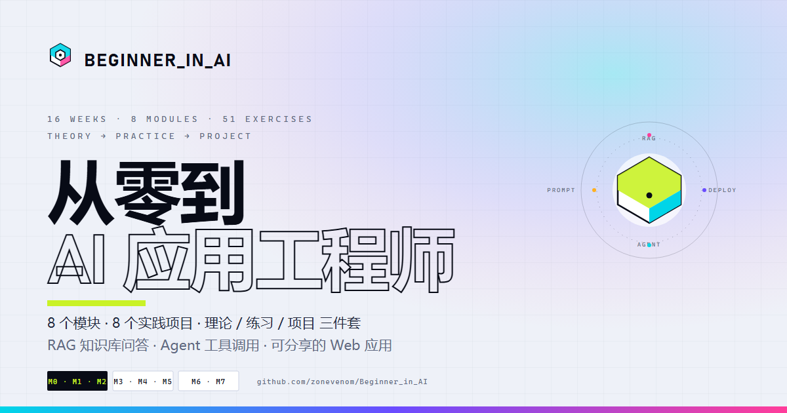

# Beginner_in_AI · 16 周大模型应用开发路线图

> 一份为「会一点 Python、数学基本忘光、看英文吃力、只有周末能集中学」的人定制的学习计划，
> 做成了一个可以直接浏览的静态站点：**8 个模块 · 51 道练习 · 8 份项目计划书**，全部串在 16 周里。

**在线浏览 → <https://zonevenom.github.io/Beginner_in_AI/>**



---

## 这是什么

不是又一份「AI 学习路线」合集，而是一条**按周末排好、每步都能交付**的路径：

| 阶段 | 周次 | 模块 | 你会得到 |
|---|---|---|---|
| 能跑起来 | W1–W4 | M0 开局 · M1 提示工程 | 跑通第一次 API 调用，写出稳定输出的提示词 |
| 会做产品 | W5–W10 | M2 对话应用 · M3 语义检索 · M4 RAG 核心 | 带记忆的聊天助手、语义搜索器、文档问答机器人 |
| 做好 | W11–W14 | M5 RAG 进阶与评估 · M6 Agent | 有准确率数字的 RAG、会自己调工具的 Agent |
| 交付 | W15–W16 | M7 部署上线 | 一个能发给别人的链接 + 作品集 |

每个模块都是同一个形状：**理论讲稿 → 练习题（含解析）→ 项目计划书**。
顺序反了，你只会变成「会复制代码的人」。

---

## 站点功能

- **亮色赛博朋克视觉**：浅色底 + 霓虹强调色、网格/HUD 角标、硬投影与故障风格标题，不跟随常见的暗色终端风。
- **完整内容在线读**：8 个模块页，每个都是「理论 / 练习 / 答案 / 项目」四个标签页，左侧带滚动跟随目录。
- **交互式进度看板**：按模块打卡「理论 / 练习 / 项目 / 能讲给外行听」，进度条与里程碑实时计算，记录存在浏览器 localStorage，不上传。
- **全站搜索**：`Ctrl/⌘ + K` 或 `/` 唤出命令面板，可搜模块、概念、题目、项目。
- **知识图谱**：手绘 SVG 路线图（8 个模块 + 地基 + 选修），窄屏自动切换为列表。
- **流程图**：Markdown 里的 Mermaid 图在浏览器端渲染，主题与站点统一。
- **零运行时依赖**：纯静态 HTML/CSS/JS；唯一第三方库是本地内置的 `mermaid.min.js`，断网也能正常显示。

---

## 仓库结构

```
Beginner_in_AI/
├── index.html                 # 首页
├── modules.html               # 8 个模块总览
├── modules/m0.html … m7.html  # 模块详情（理论 / 练习 / 答案解析 / 项目）
├── roadmap.html               # 16 周排期
├── projects.html              # 8 个实践项目
├── graph.html                 # 知识图谱
├── resources.html             # 15 份学习资料与用法
├── progress.html              # 进度看板（localStorage）
├── assets/
│   ├── css/                   # site.css 设计系统 + content.css 长文/组件
│   ├── js/site.js             # 导航、标签页、目录跟随、打卡、搜索
│   ├── img/                   # favicon、封面
│   └── vendor/mermaid.min.js  # 本地内置的 Mermaid
├── source/                    # 原始 Markdown（站点内容的数据源）
└── tools/                     # 构建脚本（Node，无 npm 依赖）
    ├── build.mjs              # 读取 source/ 生成全部 HTML + search.json + sitemap
    ├── md.mjs                 # 自写的 Markdown → HTML 渲染器（GFM 子集 + 代码高亮）
    ├── layout.mjs / content.mjs / pages-*.mjs
    └── serve.mjs              # 本地预览服务器
```

**内容与表现分离**：所有文字都在 `source/` 的 Markdown 里，改完跑一次 `npm run build` 就会重新生成整站。

---

## 本地开发

需要 Node 18+（开发时使用 Node 22）。

```bash
node tools/build.mjs        # 构建全站
node tools/serve.mjs 4173   # 本地预览 → http://127.0.0.1:4173/
node --test tools/md.test.mjs   # Markdown 渲染器的 25 个测试
```

`package.json` 里也有对应脚本：`npm run build` / `npm run serve` / `npm test`。

---

## 部署

站点由 **GitHub Pages** 直接从 `main` 分支根目录发布（`build_type: legacy`），没有任何 CI 依赖。
`build` 产物已提交在仓库里，因此克隆下来双击 `index.html` 也能离线看（搜索需要本地服务器）。

---

## 内容来源

学习计划原文与所有讲稿来自个人整理的学习材料（`source/`），参考了：

- 李宏毅《生成式 AI 导论》2024 春 · [课程主页](https://speech.ee.ntu.edu.tw/~hylee/genai/2024-spring.php)
- Datawhale《llm-universe》· [在线阅读](https://datawhalechina.github.io/llm-universe/)
- Datawhale《all-in-rag》· [在线阅读](https://datawhalechina.github.io/all-in-rag/)
- 复旦《大规模语言模型：从理论到实践》· [官方 PDF](https://llmbook-zh.github.io/)
- DeepSeek API 官方文档 · [中文文档](https://api-docs.deepseek.com/zh-cn/)
- Prompt Engineering Guide 中文版 · [提示工程指南](https://www.promptingguide.ai/zh)

资料链接与「这周该翻哪份」的对照表见站点 [资料页](https://zonevenom.github.io/Beginner_in_AI/resources.html)。

---

## 许可

- 代码（`tools/`、`assets/`）：MIT
- 文字内容（`source/` 与生成的页面）：CC BY 4.0，转载请保留出处链接

---

<sub>Built with plain HTML/CSS/JS, a hand-written Markdown renderer, and a lot of weekends.</sub>
