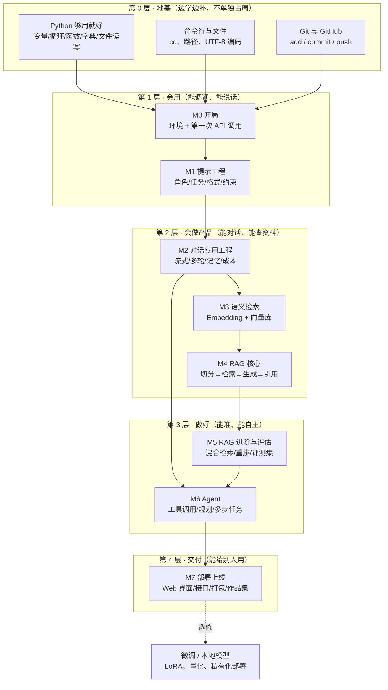
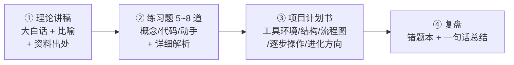

# 知识图谱总览

> 🎮 **想看可视版？** 双击打开 [`知识图谱.html`](知识图谱.html) —— 星露谷风格的农场地图：8 个模块是 8 栋建筑，点一下就知道这站学什么、做什么项目，还能打卡存档（记录在浏览器本地，和 Markdown 进度看板互相独立，用哪个都行）。

> 这份图回答一个问题：**这 16 周，我要学的东西之间是什么关系？**
> 图是给你"看清全貌"的，不用背。看不懂术语没关系，学到对应模块自然会懂。

---

## 一、主干图（从上到下 = 从前到后）

---

## 二、每个模块的内部结构（三件套）

你对我的要求是「每个小安排 = 理论 + 练习 + 项目」，所以每个模块内部都是同一个形状：

**为什么必须是这个顺序？**
- 只听理论 → 以为自己会了，一动手全懵（"知识的错觉"）
- 只做项目 → 换个需求就不会了，因为你不知道为什么这么写
- 练习是理论到项目之间的**缓冲垫**，故意设计得比理论难一点点、比项目简单一点点

---

## 三、能力地图（学完你具体能干什么）

| 模块 | 学完你能做到 | 对应岗位能力 |
|---|---|---|
| M0 | 在自己的电脑上跑通一次大模型调用，看懂返回的 JSON | 入门门槛 |
| M1 | 写出稳定输出的提示词，让模型按 JSON 格式回答 | Prompt 工程师 |
| M2 | 做出有上下文记忆的聊天界面，控制成本 | AI 应用开发 |
| M3 | 用向量把"意思相近"的文本找出来 | 检索/RAG 基础 |
| M4 | 把一堆 PDF 变成能问答的知识库，答案带出处 | **RAG 工程师（最热门）** |
| M5 | 说清楚"我的 RAG 准确率是多少"，并优化它 | RAG 工程师（进阶） |
| M6 | 让模型自己调工具、分步骤完成任务 | **Agent 开发（最抢手）** |
| M7 | 部署成链接发给别人用，写进简历 | 独立交付能力 |

---

## 四、三条学习主线（同一批知识，三种切法）

1. **按"数据流"切**：用户输入 → 提示词拼装 → 模型生成 → 后处理 → 返回用户。
   RAG 就是在这个链条中间插了"检索"，Agent 就是插了"调工具"。
2. **按"出错方式"切**：模型不知道 → 要 RAG；模型不会算/不能操作 → 要工具；模型不听话 → 要提示工程；模型太贵太慢 → 要工程优化。
3. **按"交付物"切**：脚本 → 界面 → 服务 → 产品。每升一级，多一层工程能力。

> 建议你每学完一个模块，回到这张图上用手指一下："我现在站在哪一格？"——这是防止迷路最有效的办法。

---

## 五、各模块资料对应速查

| 模块 | 主要参考（详见资料区） |
|---|---|
| M0 | 李宏毅 生成式AI导论 第1讲；llm-universe 第1章；DeepSeek API 文档 |
| M1 | 李宏毅 第2–4讲；Prompt Engineering Guide 中文版；llm-universe 第2章 |
| M2 | llm-universe 第3–4章；OpenAI Cookbook；Streamlit 文档 |
| M3 | happy-llm 第2章；all-in-rag 第2章；Chroma 文档 |
| M4 | all-in-rag 第3–5章；llm-universe 第5章；LlamaIndex 文档 |
| M5 | all-in-rag 第6–8章；复旦《大规模语言模型》第7章 |
| M6 | 李宏毅 第9讲；复旦书 第8章；LangChain / AutoGen 文档 |
| M7 | FastAPI 中文文档；Streamlit 文档；llm-universe 第6章 |
