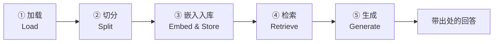

# M4 · RAG 核心：让模型"看着材料回答"

> **【资料出处】**
> - Datawhale《all-in-rag》主流程章节（文档解析 → 切分 → 入库 → 检索 → 生成）—— https://datawhalechina.github.io/all-in-rag/
> - Datawhale《llm-universe》第 5 章（构建 RAG 应用）—— https://datawhalechina.github.io/llm-universe/
> - 复旦《大规模语言模型：从理论到实践》**第 7 章**（检索增强生成）—— https://llmbook-zh.github.io/
> - 李宏毅《生成式 AI 导论》第 6–8 讲（模型为什么不知道你的私有数据）—— https://speech.ee.ntu.edu.tw/~hylee/genai/2024-spring.php

---

## 【这一讲要解决什么】

学完这一讲，你能：

1. 用"开卷考试"讲清楚 RAG 是什么，以及它**治好了什么病**
2. 说清 RAG 的**五个环节**，每个环节出错会有什么症状
3. 自己切分文档、建索引、检索、拼提示词，做出一个**带出处的问答机器人**
4. 知道 RAG 的**四种典型失败**，以及分别该往哪调

---

## 一、先讲清楚 RAG 是什么

### 一句话

> **RAG = 检索（Retrieval）+ 增强（Augmented）+ 生成（Generation）。**
> 说人话：**先去你的资料里翻出几段相关的，再把这些段落塞给模型，让它照着回答。**

### 开卷考试的比喻

- **闭卷考试**（现在的模型）：全靠脑子里的记忆答题。记不清就**编**。
- **开卷考试**（RAG）：允许翻书。翻到哪页，就照着那页答。

**RAG 就是给模型发了一本书，还配了个图书管理员。**

管理员（检索）负责找到对的那几页；模型（生成）负责读懂并回答。

### 它治好了三个病

| 病 | 症状 | RAG 怎么治 |
|---|---|---|
| **幻觉** | 不知道也硬编 | 把真材料放在它眼前，它从"回忆"变成"阅读理解" |
| **知识过时** | 训练截止日期之后的事不知道 | 资料换成最新的，模型不用重训 |
| **私有数据** | 不知道你公司的制度、你的笔记 | 把私有资料放进库，它就能答 |

> 第三条是商业价值最大的：**企业不需要训练模型，只需要把自己的文档接进去。**

---

## 二、RAG vs 微调 vs 长上下文：别再选错

很多人一上来就想"微调"，这是最常见的战略错误。

| 方案 | 做法 | 成本 | 适合什么 | 不适合什么 |
|---|---|---|---|---|
| **RAG** | 检索资料塞进提示词 | 低 | **知识型问答、文档问答、需要出处** | 改变说话风格、学新技能 |
| **微调（Fine-tune）** | 用你的数据继续训练 | 中高 | **固定风格、固定格式、特定任务** | 灌知识（效果差且易忘） |
| **长上下文** | 把整本书塞进去 | 高（按 token 付费） | 一次性分析一份长文档 | 反复查询（每次都付全款） |

### 一句话判断

> **"它不知道" → 用 RAG；"它不会做/做得不像" → 用微调；"就这一次，材料不多" → 直接塞上下文。**

对你来说：**16 周内不碰微调**。RAG 能解决你 90% 的需求，而且面试问得更多。

---

## 三、RAG 的五个环节（背下来，这是你的地图）



前三个是**离线**做的（建库，只做一次）；后两个是**在线**做的（每次提问都跑）。

| 环节 | 干什么 | 出错的症状 |
|---|---|---|
| ① 加载 | 把 PDF/Word/网页变成纯文本 | 表格变乱码、页眉页脚混进来、段落顺序乱 |
| ② 切分 | 把长文切成几百字的小块 | **切断了语义**，一块里只有半句话 |
| ③ 嵌入入库 | 每块变成向量存起来 | 模型混用、维度不一致、没归一化 |
| ④ 检索 | 找出最相关的几块 | 找错、找不到、找太多 |
| ⑤ 生成 | 把几块塞进提示词让模型答 | 不引用、答超出材料、把不相关的也答进去 |

> **排查 RAG 的第一原则：先看"检索到的内容对不对"，再看"回答写得好不好"。**
> 90% 的"答得烂"，其实是"根本没检索到"。

---

## 四、切分（Chunking）：RAG 里最被低估的一步

### 为什么必须切

三个原因：

1. **上下文窗口有限**，整本书塞不进去
2. **太长的块会"稀释"语义**（M3 讲过）：一块 5000 字里只有 100 字相关，向量就被带偏
3. **成本**：每次塞 10 万字，你会破产

### 三种切法

#### 切法 1：固定长度 + 重叠（最常用）

```python
def split_fixed(text, chunk_size=500, overlap=50):
    chunks = []
    start = 0
    while start < len(text):
        chunks.append(text[start:start + chunk_size])
        start += chunk_size - overlap
    return chunks
```

- `chunk_size`：每块多长（按**字符**算，中文 1 字 ≈ 1~2 token）
- `overlap`：相邻块重叠多少

**为什么要 overlap？**

因为句子会被切断。假设切在"退款需要 3-5 个工"和"作日原路退回"之间，两块都读不通。
**重叠 50 字，就能保证每句话至少在一块里是完整的。**

**参数怎么定**：

| 文档类型 | chunk_size | overlap |
|---|---|---|
| 制度/条款（一句话就是一个规定） | 300~500 | 50 |
| 教程/文章（一段一个意思） | 500~800 | 80~100 |
| 论文/报告（逻辑长） | 800~1200 | 150 |

> **没有"最佳参数"，只有"测出来的参数"。** M5 会让你用评测集找出你自己的最优值。

#### 切法 2：按结构切（更好，但要有结构）

按标题、段落、列表项切。比如按 `## 二级标题` 切，每节一块。

**优点**：语义完整，天然带层级。
**缺点**：依赖文档本身有结构（PDF 转出来常常没有）。

#### 切法 3：父子块（最实用进阶）

- **小块**用来检索（精准）
- **大块**用来喂给模型（上下文完整）

比如：用 200 字的块去检索，命中后把它所属的 1000 字的大段一起给模型。

**这叫"小块检索、大块生成"**，是目前效果最好的通用策略之一。

### 三个必须处理的脏数据

| 脏东西 | 怎么处理 |
|---|---|
| **页眉页脚、页码** | 正则删掉重复出现的行 |
| **断行**（PDF 每行都硬换行） | 把单个 `\n` 换成空格，保留 `\n\n` |
| **表格** | 单独处理，转成 Markdown 或"字段：值"的文本，别硬切 |

> **表格是 PDF 解析的最大噩梦。** 如果你的文档里表格多，先做好心理准备：M5 会教你怎么评估"表格答得好不好"。

---

## 五、生成：提示词长什么样

这是 RAG 的"最后一公里"，也是最容易写错的地方。

### ❌ 错误写法

```
请根据以下内容回答问题：{context}
问题：{question}
```

**问题**：

- 没说"只能用这些内容" → 它会自己脑补
- 没要求引用 → 你不知道它说的是真是假
- 没允许说"不知道" → 它一定会给个答案

### ✅ 正确写法

```
你是一个严谨的文档问答助手。请**只**根据下面提供的资料回答问题。

规则：
1. 只能使用资料中的信息，不要使用你自己的知识。
2. 每个结论后面用 [编号] 标注来源，例如 [1]。
3. 如果资料里没有足够信息，直接回答"根据现有资料无法回答"，不要猜测。
4. 回答简洁，不超过 200 字。

资料：
[1] {chunk_1}
[2] {chunk_2}
[3] {chunk_3}

问题：{question}
```

### 四条规则，每条都在解决一个具体问题

| 规则 | 解决什么 |
|---|---|
| "只根据资料" | 抑制幻觉 |
| "标注 [编号]" | **可验证**，用户能点开看原文 |
| "没有就说无法回答" | 允许拒绝，这是**质量**不是缺陷 |
| "不超过 200 字" | 控成本、防啰嗦 |

> **"允许说不知道"是 RAG 系统成熟的标志。** 一个从不说"不知道"的 RAG，一定在骗人。

---

## 六、引用与溯源：RAG 的产品灵魂

回答里带 `[1]`，用户能点开看原文——这个功能看着小，其实决定了产品能不能被信任。

### 实现方式

在**检索阶段**就保留元数据：

```python
chunk = {
    "id": "doc1_p3_c2",
    "text": "退款需要 3-5 个工作日……",
    "source": "售后政策.pdf",
    "page": 3,
    "chunk_index": 2,
}
```

拼提示词时带上编号，回答后把编号映射回元数据：

```python
refs = {f"[{i+1}]": c["source"] + f" 第{c['page']}页" for i, c in enumerate(chunks)}
```

**没有元数据的 RAG，等于没有出处的论文。** 用户看一眼不会信，你自己也没法调试。

---

## 七、RAG 的四种典型失败（照着这张表排查）

| # | 症状 | 大概率原因 | 往哪调 |
|---|---|---|---|
| 1 | 答"资料里没有"，但明明有 | **检索没找到** | 切分太碎/太大、embedding 模型不合适、查询和文档表述差异大 → 加**查询改写**或**混合检索**（M5） |
| 2 | 找到了对的块，但答错 | **上下文太杂**（塞了 10 块，8 块无关） | 减小 top-k、加阈值、加**重排**（M5） |
| 3 | 答对了但没引用/引用错 | 提示词没约束，或编号映射错 | 改提示词、检查 `refs` 映射 |
| 4 | 答得又长又飘，超出材料 | 没限制"只用资料" | 加"只能使用资料""不超过 N 字" |

### 排查顺序（记住这个顺序，能省你一半时间）

```
① 打印检索到的 chunk 原文 → 内容对吗？
   不对 → 问题在检索（①②③环节）
   对   → 进 ②
② 看提示词里塞了什么 → 是不是塞太多/太少？
③ 看模型回答 → 有没有遵守"只用资料""要引用"？
```

> **永远先怀疑检索，再怀疑模型。** 这是 RAG 调试的铁律。

---

## 八、一个完整的最小实现（伪代码，看懂结构）

```python
# ---------- 离线：建库（只跑一次） ----------
text = load_pdf("售后政策.pdf")                    # ① 加载
chunks = split_fixed(clean(text), 500, 50)         # ② 切分
vecs = embed_texts([c.text for c in chunks])       # ③ 嵌入
save_index(chunks, vecs)                           #    入库

# ---------- 在线：回答（每次提问） ----------
def answer(question):
    qv = embed_one(question)                       # ④ 检索
    hits = top_k(chunks, vecs, qv, k=3)

    context = "\n".join(f"[{i+1}] {h.text}" for i, h in enumerate(hits))
    prompt = RAG_TEMPLATE.format(context=context, question=question)

    reply = chat(prompt)                           # ⑤ 生成
    return reply, [h.source for h in hits]         #    带回出处
```

**这 15 行，就是 RAG 的全部。** 剩下的所有复杂度，都是在优化这 15 行里的每一步。

---

## 【常见误解】

**误解 1："RAG 能消灭幻觉。"**
不能。它**降低**幻觉。如果检索到的内容本身是错的、或者模型没遵守"只用资料"，照样会错。RAG 把"编造"变成了"可能读错"，这是进步但不是终点。

**误解 2："切得越细越准。"**
太细会丢上下文（"3-5 个工作日"单独一块，不知道说的是退款还是发货）。**要"一句完整的话"，不是"一个词"。**

**误解 3："top-k 越大越好，多给点总没错。"**
错。无关内容会**干扰**模型（"lost in the middle"：模型对中间位置的上下文最不敏感）。k=3~5 通常最好。

**误解 4："RAG 就是把文档扔给模型。"**
"扔"是长上下文方案，贵且不准。RAG 的核心价值是**"先筛后给"**——筛这一步才是技术含量所在。

---

## 【自检清单】

1. 用开卷考试解释 RAG，并说出它治好的三个病。
2. RAG / 微调 / 长上下文，分别什么时候用？各一句话。
3. 五个环节是哪五个？哪三个是离线的？
4. 为什么切分要 overlap？overlap 太大有什么坏处？
5. RAG 提示词里必须有的四条规则是什么？每条解决什么问题？
6. 回答"资料里没有"但明明有时，你先怀疑哪一步？为什么？

---

## 【下一站】

- **练习**：`03_练习题目区/M4_RAG核心/01_题目.md`
- **项目**：`04_实践项目区/P5_个人文档问答机器人/00_项目计划书.md`
