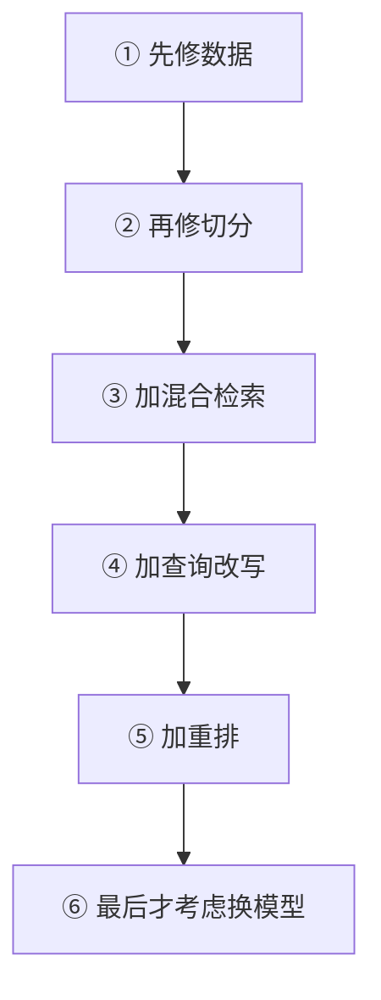

# M5 · RAG 进阶与评估：把"感觉还行"变成"命中率 80%"

> **【资料出处】**
> - Datawhale《all-in-rag》切分策略 / 混合检索 / 重排 / 评估章节 —— https://datawhalechina.github.io/all-in-rag/
> - 复旦《大规模语言模型：从理论到实践》第 7 章后半（RAG 的挑战与优化）—— https://llmbook-zh.github.io/
> - 李宏毅《生成式 AI 导论》第 12 讲《浅谈检定大型语言模型能力的各种方式》—— https://speech.ee.ntu.edu.tw/~hylee/genai/2024-spring.php
> - 《Prompt Engineering Guide》· ReAct / 查询改写 —— https://www.promptingguide.ai/zh

---

## 【这一讲要解决什么】

学完这一讲，你能：

1. 用**四个指标**说清你的 RAG 到底多好（而不是"感觉还行"）
2. 诊断检索失败的**四种病**，对症下药
3. 实现**混合检索**（关键词 + 向量）和**重排**（rerank）
4. 建一套 20 题的评测集，做出"优化前 62% → 优化后 81%"这种结论

---

## 一、先承认一件事：你的 v1 一定不够好

P5 做完，你大概会遇到这些情况：

- 明明文档里有，它就是找不到
- 找到了，但答得不对
- 答对了，但引用了三页不相关的内容
- 问了个稍微绕一点的说法，直接崩

**这不是你的错，是 RAG 的正常状态。** 论文里叫它 "naive RAG"——朴素 RAG。

**工业界的 RAG，普遍要在这个基础上做 3~4 轮优化。** 这一讲就是那 3~4 轮。

---

## 二、先把"好"定义出来：四个指标

没有指标，你所有的优化都是玄学。RAG 至少要看四个数：

### 指标 1：Recall@k（召回率）—— 最核心

> **在召回的 k 条里，有没有"包含答案的那一条"？**

- 你建了 20 道题，每道题你都知道"答案在第几块"（这叫 gold chunk）
- 检索 top-5，看这 5 条里有没有 gold chunk
- 有 → 这题算命中

```
Recall@5 = 命中的题数 / 总题数
```

**这是 RAG 的"生死线"**：**如果 gold chunk 不在召回结果里，后面的模型再强也没用**——它根本没看到答案。

### 指标 2：Precision@k（精确率）

> **召回的 k 条里，有几条是相关的？**

```
Precision@3 = 相关的条数 / 3
```

Precision 低说明"噪声多"，会让模型分心。

### 指标 3：答对率（Answer Accuracy）

> 人工判断：最终回答对不对（含"该拒答时拒答了"）。

这个最贴近用户感受，但要人工标注，成本高。

### 指标 4：引用正确率

> 回答里引用的页码，是不是真的支持那个结论。

**这个指标最能体现"产品成熟度"**，但大多数教程都不提。

### 四个指标一起看

| 场景 | Recall@5 | Precision@3 | 答对率 | 说明 |
|---|---|---|---|---|
| A | 0.9 | 0.3 | 0.5 | 检索到了但噪声大 → **加阈值/重排** |
| B | 0.4 | 0.9 | 0.35 | 找得准但找不全 → **加大 k/混合检索** |
| C | 0.9 | 0.9 | 0.4 | 检索完美但答不对 → **改提示词/换模型** |
| D | 0.4 | 0.3 | 0.2 | **全部要改，先改切分** |

> **这张表就是你的"体检报告"。** 先看哪个低，再决定改哪里——**不要瞎改**。

---

## 三、检索失败的四种病

### 病 1：根本没召回（Recall 低）

**症状**：问"退款多久到账"，检索结果里全是"退款政策总则"这种大而空的块。

**病因与药**：

| 病因 | 药 |
|---|---|
| 切分太碎，答案被切成两半 | 加大 chunk_size / 加 overlap / **父子块** |
| 用户说法和文档说法差异大 | **查询改写**（下面讲） |
| 只有向量检索，遇到精确词就废 | **混合检索**（下面讲） |
| 文档本身没写（真没有） | 补文档，别硬调 |

### 病 2：召回了但排太后（Recall@5 低，Recall@50 高）

**症状**：top-3 里没有，但 top-10 里有。

**病因**：向量相似度排序不准。

**药**：**重排（Rerank）**——先粗召 30 条，再用更贵的模型精排出 top-3。

### 病 3：召回了但噪声多（Precision 低）

**症状**：top-5 里有 4 条不相关，模型被带偏，答得又长又乱。

**药**：加阈值、减小 k、**加重排**。

### 病 4：检索对了但答错（答对率低，Recall 高）

**症状**：gold chunk 在 context 里，但它还是答错。

**药**：这是**生成层**的问题：
- 提示词没写"只用资料"
- temperature 太高
- context 太长，关键信息被"埋"在中间（lost in the middle）
- 模型能力不足（最后才考虑换模型）

> **排查顺序永远是：先看检索，再看生成。** 90% 的人一上来就换模型，白花钱。

---

## 四、四把武器

### 武器 1：查询改写（Query Rewriting）

用户的问法，往往和文档的写法差很远。

**做法 A：多查询（Multi-Query）**

让模型把一个问题改写成 3 个不同说法，分别检索，结果合并去重。

```
原问题：钱什么时候能退回来
改写 1：退款到账时间是多久
改写 2：退款多久能收到
改写 3：退款处理周期
```

**为什么有效**：一句话可能"碰巧"命中，三个说法命中概率高得多。

**代价**：3 倍检索调用（但检索很便宜，主要是 embedding 调用）。

**做法 B：HyDE（假设文档嵌入）**

让模型**先编一个假答案**，然后拿这个假答案去检索。

```
问题：退款多久到账？
假答案（模型编的）：退款一般需要 3-5 个工作日原路退回……
→ 用这段假答案去检索 → 更容易命中真实的政策段落
```

**为什么有效**：假答案的"用词风格"更接近真实文档（都是陈述句、都用"工作日""原路退回"），而用户的提问风格（疑问句、口语）离文档远。

> 这招很反直觉，但效果实在。**注意：编出来的内容只用来检索，绝对不能当答案。**

**做法 C：指代消解（多轮对话时）**

```
用户：退款多久到账？
用户：那如果是质量问题呢？      ← "那"指什么？
```

先把"那如果是质量问题呢"改写成"质量问题导致的退款多久到账"，再检索。**不消解，第二句必崩。**

---

### 武器 2：混合检索（Hybrid Search）

**向量检索擅长"意思"，关键词检索（BM25）擅长"精确词"。两个都要。**

```
向量检索 top-10  ─┐
                  ├→ 融合排序 → top-10
BM25 检索 top-10 ─┘
```

**怎么融合？最常用的是 RRF（Reciprocal Rank Fusion，倒数排名融合）**

不要被名字吓到，公式就一行：

```
score(d) = Σ  1 / (k + rank_i(d))
```

人话：**每个检索器给文档排个名，排名越靠前得分越高，然后把两个得分加起来。**

- `k` 通常取 60（经验值，防止分母为 0，也压平差距）
- 一个文档在向量里排第 1、在 BM25 里排第 5，得分 = 1/61 + 1/65

```python
def rrf(vec_ids, bm25_ids, k=60):
    score = {}
    for rank, doc_id in enumerate(vec_ids, start=1):
        score[doc_id] = score.get(doc_id, 0) + 1 / (k + rank)
    for rank, doc_id in enumerate(bm25_ids, start=1):
        score[doc_id] = score.get(doc_id, 0) + 1 / (k + rank)
    return sorted(score, key=score.get, reverse=True)
```

**为什么用"排名"而不是"分数"**：因为向量相似度（0~1）和 BM25 分数（0~几十）**量纲完全不同**，不能直接相加。**转成排名就统一了。**

> 这个洞察是 RRF 的全部精髓：**不同尺度的分数不能加，但排名可以。**

---

### 武器 3：重排（Rerank）

**思路**：粗排用便宜的（向量，毫秒级，召 30 条），精排用贵的（Cross-encoder，几百毫秒，排 3 条）。

```
30 条候选 → Cross-encoder 逐条打分 → 取 top-3
```

**Cross-encoder 和向量检索的区别**：

| | 向量检索（Bi-encoder） | Cross-encoder |
|---|---|---|
| 怎么算 | 问题和文档**分别**编码，算距离 | 问题和文档**拼在一起**送进模型 |
| 速度 | 快（可预计算） | 慢（每对都要跑一次） |
| 精度 | 中 | **高**（能看到两者的交互） |

**所以你不可能用它检索全库**（10 万条要跑 10 万次），只能用来"精排少量候选"。

**实现方式**：
- 商用 API：Cohere Rerank、Jina Reranker、国内几家厂商也有
- 本地：`sentence-transformers` 的 `BAAI/bge-reranker-*`（CPU 也能跑，几百 MB）

> 🛑 **装 rerank 模型前先问我**。它要下载几百 MB，且需要确认你的 CPU 跑得动。

---

### 武器 4：上下文扩展（父子块 / 句子窗口）

**思路**：用小块检索（准），命中后把**它周围的大段**一起给模型（全）。

```
检索命中：块 #37（"3-5 个工作日原路退回"）
扩展：把 #36 #37 #38 一起给模型  ← 前后各扩一块
```

**为什么有效**：解决"切断了语义"的问题，且**不增加索引复杂度**（只是检索后多取几条）。

**代价**：context 变长，token 成本上升。**扩展 1 块通常就够，别扩太多。**

---

## 五、优化顺序（这比技术本身重要）

很多人一上来就上 rerank、换模型，结果白花钱。正确的顺序是：



| 顺序 | 做什么 | 典型收益 | 成本 |
|---|---|---|---|
| ① | 清洗脏数据、去掉页眉页脚、修表格 | **10~20%** | 极低 |
| ② | 调 chunk_size / overlap / 父子块 | **5~15%** | 极低 |
| ③ | 混合检索（BM25 + 向量） | **5~10%** | 低 |
| ④ | 查询改写 | **3~8%** | 低（多几次调用） |
| ⑤ | 重排 | **5~10%** | 中（要模型/API） |
| ⑥ | 换更强的生成模型 | **0~5%** | **高** |

> **注意最后一行：换模型往往是收益最小、成本最高的一步。**
> 这就是为什么"先修检索"是铁的纪律。

---

## 六、怎么建评测集（20 题就够）

### 三条原则

| 原则 | 说明 |
|---|---|
| **必须人工写标准答案** | 不能让模型生成答案当标准，那是自己考自己 |
| **必须标注 gold chunk** | 否则你算不出 Recall |
| **必须包含"应该拒答"的题** | 否则你不知道它会不会瞎编 |

### 题目配比（20 题）

| 类型 | 数量 | 作用 |
|---|---|---|
| 简单事实（原文直接有） | 6 | 基线，必须全对 |
| 同义改写（换说法） | 5 | 测语义检索能力 |
| 跨段/跨页 | 4 | 测切分与上下文扩展 |
| 精确信息（数字、编号） | 3 | 测是否需要混合检索 |
| **应该拒答** | 2 | 测幻觉控制 |

### 数据格式

```json
[
  {
    "q": "退款多久到账？",
    "gold_ids": ["售后政策_p3_c0"],
    "gold_answer": "3-5 个工作日原路退回",
    "type": "简单",
    "should_refuse": false
  },
  {
    "q": "你们支持花呗分期吗？",
    "gold_ids": [],
    "gold_answer": "",
    "type": "拒答",
    "should_refuse": true
  }
]
```

---

## 七、评测脚本长什么样（骨架）

```python
def evaluate(rag, cases, k=5):
    hit = 0
    correct = 0
    refuse_ok = 0
    for c in cases:
        hits = rag.retrieve(c["q"], k=k)
        ids = [h["id"] for h in hits]

        # Recall@k：gold 有没有在召回里
        if c["should_refuse"]:
            ok_retrieval = True
        else:
            ok_retrieval = any(g in ids for g in c["gold_ids"])
        hit += int(ok_retrieval)

        ans = rag.answer(c["q"])
        if c["should_refuse"]:
            ok = ("无法回答" in ans) or ("没有" in ans)
            refuse_ok += int(ok)
        else:
            ok = judge(ans, c["gold_answer"])   # 人工或用模型判
        correct += int(ok)

    n = len(cases)
    return {
        "recall": hit / n,
        "accuracy": correct / n,
        "refuse_acc": refuse_ok / max(1, sum(c["should_refuse"] for c in cases)),
    }
```

> `judge()` 这一步，初期**建议人工判**（20 题而已，10 分钟）。等题库到 200 题，再考虑用模型当裁判（LLM-as-judge）。

---

## 【常见误解】

**误解 1："Recall 高就说明 RAG 好。"**
不。Recall 高只说明"找得到"，答得对不对是另一回事（看第三节病 4）。

**误解 2："重排能救一切。"**
不能。如果 gold chunk 压根没进候选集（召回阶段就丢了），重排排不出来。**重排只能优化"候选集里已有"的东西。**

**误解 3："top-k 越大越好。"**
越大召回越高，但噪声也越多，且成本线性上升。**正确做法：粗召大（30）、精排小（3）。**

**误解 4："评测是最后做的。"**
错。**评测要在优化之前就做**。没有基线，你无法证明"优化有效"，只能说"感觉好了"。

---

## 【自检清单】

1. 四个指标分别是什么？哪个是"生死线"？
2. 检索失败有哪四种病？各自的药是什么？
3. 混合检索为什么用"排名融合"而不是"分数相加"？
4. 重排为什么不能用来检索全库？
5. 为什么"换模型"要放在优化顺序的最后？
6. 评测集必须有哪三类题？为什么要有"应该拒答"的？

---

## 【下一站】

- **练习**：`03_练习题目区/M5_RAG进阶与评估/01_题目.md`
- **项目**：`04_实践项目区/P6_带评测的RAG_v2/00_项目计划书.md`
