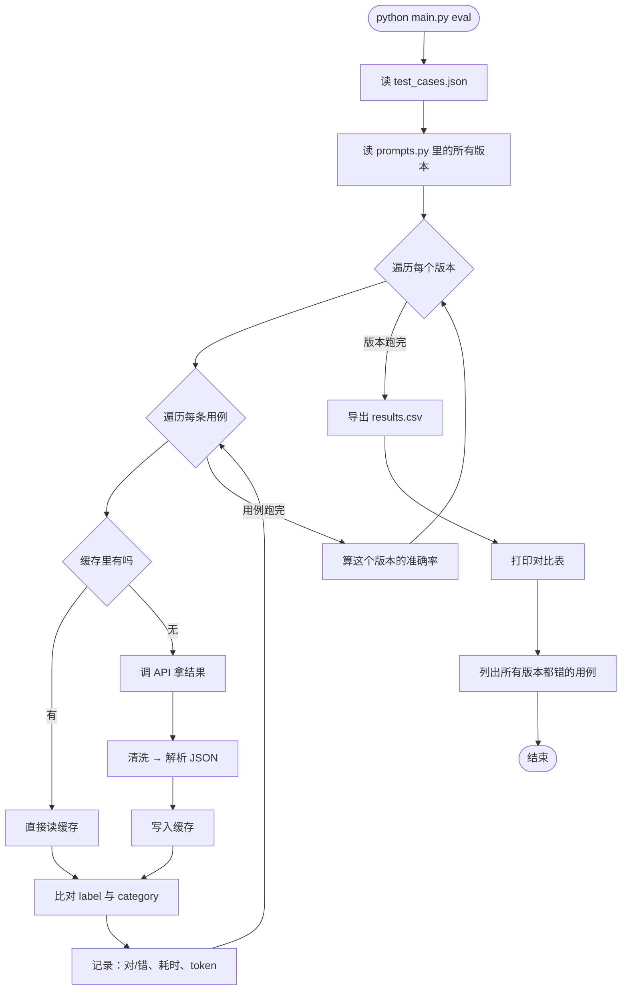

# P2 项目计划书 · 提示词实验台（Prompt Lab）

> 难度：⭐⭐ ｜ 周期：一个周末（约 3 小时）｜ 学习模块：M1
> **采用的资料**：见文末第 7 节

---

## 1. 项目要做什么

### 一句话

做一个能在命令行里**同时跑多版提示词、自动打分、输出对比表**的小工具，让你用**数据**而不是**感觉**判断"哪版提示词更好"。

### 为什么做这个

90% 的人调提示词是这样调的：

> 改一改 → 跑一次 → "嗯，感觉好多了" → 收工。

这是**玄学**。你无法回答："到底好了多少？""是不是这次运气好？"

做完这个工具，你能说：

> "v3 在 20 条测试集上准确率 90%，v2 是 75%，v1 是 60%。主要提升来自加了分类定义。"

**这句话，就是面试时最值钱的东西。**

### 验收标准

- [ ] 有 ≥3 个版本的提示词，集中在一个文件里管理
- [ ] 有 ≥15 条带标准答案的测试数据
- [ ] 一条命令能跑完全部（提示词 × 测试用例）
- [ ] 输出一张表：每个版本的准确率
- [ ] 能导出 `results.csv`，能指出"哪个用例所有版本都错"
- [ ] 再跑一次不会重复花钱（有缓存）

---

## 2. 工具与开发环境

> 🛑 装之前先跟我说。这次**不用装新东西**，P1 的 `openai` + `dotenv` 就够。

| 工具 | 是否新增 | 用途 |
|---|---|---|
| Python 3.10+ | 已有 | 运行 |
| `openai` | P1 已装 | 调模型 |
| `python-dotenv` | P1 已装 | 读 Key |
| `json` / `csv` | 标准库 | 读写数据 |
| `hashlib` | 标准库 | 做缓存键 |
| VS Code | 已有 | 写代码 |

**零新增依赖。** 这是故意的：**能用标准库解决的，绝不装库。**

---

## 3. 项目文件结构

```
p2-prompt-lab/
├── .env                  ← Key
├── .gitignore
├── config.py             ← 模型名、温度、路径等常量
├── prompts.py            ← 所有提示词版本（核心资产）
├── test_cases.json       ← 测试集（带标准答案）
├── runner.py             ← 单次调用 + JSON 解析 + 缓存
├── evaluate.py           ← 批量跑 + 算准确率 + 导出 CSV
├── main.py               ← 命令行入口
├── cache/                ← 缓存（自动生成）
│   └── <hash>.json
└── results.csv           ← 结果（自动生成）
```

### 每个文件为什么存在

| 文件 | 里面放什么 | 为什么单独拆 |
|---|---|---|
| `prompts.py` | `PROMPTS = {"v1": "...", "v2": "...", "v3": "..."}` | **提示词是资产**，要像代码一样版本管理 |
| `test_cases.json` | `[{"input": "...", "label": "物流"}, ...]` | 测试数据与代码分离，方便你随时加数据 |
| `runner.py` | `call_llm(prompt, text) -> dict` | 只负责"调一次"，不管业务 |
| `evaluate.py` | `evaluate_all() -> list[dict]` | 只负责"跑一批、算分" |
| `main.py` | 解析命令行参数，调用上面两个 | 入口 |

> **这是你第一次做"分层"。** 体会一下：改提示词不用碰 runner，换模型不用碰 evaluate。这就是"解耦"。

---

## 4. 项目流程图



### 关键设计点

- **缓存优先于调用**：重复跑不花钱，也让你敢反复试。
- **先解析再比对**：解析失败要记为"格式错误"，**单独统计**——因为"格式错"和"判断错"是两种病。
- **同时统计"全员失败"的用例**：这是你下一步优化的靶子。

---

## 5. 分步实现

### Step 1 · 定义三个版本的提示词（40 分钟，最需要动脑）

`prompts.py`：

```python
# 所有提示词版本都放这里。每次改动 = 新增一个版本，不要改旧的。
# 这样你永远能复现"当时那版是什么样"。

V1 = """请把下面的客户留言分类为：退款、物流、质量、其他。

留言：{text}"""

V2 = """请把下面的客户留言分类为：退款、物流、质量、其他。

分类标准：
- 退款：明确要求退钱、退货、取消订单
- 物流：催促发货、查快递、说送错/送慢
- 质量：商品破损、有异味、用不了
- 其他：咨询、投诉态度、建议

留言：{text}"""

V3 = """你是一名电商客服主管。请把下面的客户留言分类。

分类标准：
- 退款：明确要求退钱、退货、取消订单
- 物流：催促发货、查快递、说送错/送慢
- 质量：商品破损、有异味、用不了
- 其他：咨询、投诉态度、建议

如果同时符合多类，按"退款 > 质量 > 物流 > 其他"的优先级取第一个。

只输出 JSON，不要任何解释：
{{"category": "退款|物流|质量|其他", "reason": "不超过20字"}}

留言：
\"\"\"
{text}
\"\"\""""

PROMPTS = {"v1": V1, "v2": V2, "v3": V3}
```

**三个版本各自只改了一件事**：
- v1 → v2：**加分类定义**
- v2 → v3：**加优先级 + 改 JSON 输出**

这样你才能归因。

> ⚠️ 注意 `V3` 里用了 `{{` 和 `}}`：因为后面要用 `.format()`，单个 `{` 会被当成占位符报错。**这是 Python 字符串格式化的经典坑。**

---

### Step 2 · 准备测试集（30 分钟）

`test_cases.json`，先写 15 条，**标签必须你自己判定**（不要问模型，那等于作弊）：

```json
[
  {"input": "收到货就坏了，能退吗", "label": "退款"},
  {"input": "三天了还没发货", "label": "物流"},
  {"input": "衣服上有股味道", "label": "质量"},
  {"input": "请问发票怎么开", "label": "其他"},
  {"input": "我要退货退款", "label": "退款"},
  {"input": "快递显示签收但我没收到", "label": "物流"},
  {"input": "用了两天就裂了", "label": "质量"},
  {"input": "能不能便宜点", "label": "其他"},
  {"input": "申请退款一直没处理", "label": "退款"},
  {"input": "发货太慢了", "label": "物流"},
  {"input": "和图片色差很大", "label": "质量"},
  {"input": "你们客服态度真差", "label": "其他"},
  {"input": "不想要了，退钱", "label": "退款"},
  {"input": "快递员放错地方了", "label": "物流"},
  {"input": "充电口松动", "label": "质量"}
]
```

**写测试集的三条原则**：

1. **要包含"混合类"**（如"质量差还要退款"）——这才是真实数据，也最能区分提示词好坏。
2. **要包含几条例外/刁钻的**（如"能不能便宜点"）——看它会不会瞎归类。
3. **数据要自己写，不要用模型的输出当标签**。否则你测的是"模型像不像模型"。

---

### Step 3 · 写 runner（40 分钟）

```python
# runner.py
import hashlib
import json
import os
import re
import time

from dotenv import load_dotenv
from openai import OpenAI

load_dotenv()

client = OpenAI(
    api_key=os.getenv("DEEPSEEK_API_KEY"),
    base_url="https://api.deepseek.com",
)

CACHE_DIR = "cache"
os.makedirs(CACHE_DIR, exist_ok=True)

VALID = {"退款", "物流", "质量", "其他"}


def _cache_key(prompt: str, text: str) -> str:
    raw = f"{prompt}||{text}".encode("utf-8")
    return hashlib.md5(raw).hexdigest()


def parse_category(raw: str) -> str | None:
    """从模型输出里抠出分类。返回 None 表示解析失败。"""
    raw = (raw or "").strip()
    raw = re.sub(r"^```(?:json)?|```$", "", raw, flags=re.M).strip()

    # 先试 JSON
    try:
        data = json.loads(raw)
        cat = str(data.get("category", "")).strip()
        return cat if cat in VALID else None
    except json.JSONDecodeError:
        pass

    # 再试：直接在里面找这四个词之一
    for cat in VALID:
        if cat in raw:
            return cat
    return None


def call_llm(prompt_template: str, text: str, retries: int = 2) -> dict:
    """调一次模型，带缓存和重试。"""
    prompt = prompt_template.format(text=text)
    key = _cache_key(prompt_template, text)
    path = os.path.join(CACHE_DIR, f"{key}.json")

    if os.path.exists(path):
        with open(path, encoding="utf-8") as f:
            return json.load(f) | {"cached": True}

    last_err = None
    for i in range(retries + 1):
        try:
            t0 = time.time()
            resp = client.chat.completions.create(
                model="deepseek-chat",
                messages=[{"role": "user", "content": prompt}],
                temperature=0,
            )
            content = resp.choices[0].message.content
            result = {
                "raw": content,
                "category": parse_category(content),
                "tokens": resp.usage.total_tokens,
                "seconds": round(time.time() - t0, 2),
                "error": None,
                "cached": False,
            }
            break
        except Exception as e:          # 教学版：先抓宽一点，方便你看到报错
            last_err = str(e)
            if i < retries:
                time.sleep(1 + i)
            else:
                result = {
                    "raw": "",
                    "category": None,
                    "tokens": 0,
                    "seconds": 0,
                    "error": last_err,
                    "cached": False,
                }

    with open(path, "w", encoding="utf-8") as f:
        json.dump(result, f, ensure_ascii=False, indent=2)
    return result
```

**四个设计要点，每个都值得你停下来想一分钟**：

| 设计 | 为什么 |
|---|---|
| `temperature=0` | 评估要可复现。带随机性的评估没有意义 |
| 缓存键 = 提示词 + 文本的哈希 | 提示词改了，缓存自动失效。**不用手动清** |
| `parse_category` 双路兜底 | JSON 解析失败还能靠关键词救。**但救了要能看出是"救的"** |
| `except Exception` 抓宽 | 教学阶段先看到错误；生产环境要抓具体类型（P1 教过） |

---

### Step 4 · 写 evaluate（40 分钟）

```python
# evaluate.py
import csv
import json

from prompts import PROMPTS
from runner import call_llm


def load_cases(path="test_cases.json"):
    with open(path, encoding="utf-8") as f:
        return json.load(f)


def evaluate_all():
    cases = load_cases()
    rows = []
    summary = {}

    for name, tpl in PROMPTS.items():
        correct = 0
        format_err = 0
        call_err = 0
        total_tokens = 0

        for c in cases:
            r = call_llm(tpl, c["input"])
            total_tokens += r["tokens"]

            if r["error"]:
                call_err += 1
                ok = None
            elif r["category"] is None:
                format_err += 1
                ok = None
            else:
                ok = (r["category"] == c["label"])
                correct += int(ok)

            rows.append({
                "version": name,
                "input": c["input"],
                "label": c["label"],
                "pred": r["category"] or "",
                "correct": "" if ok is None else int(ok),
                "tokens": r["tokens"],
                "seconds": r["seconds"],
                "error": r["error"] or "",
            })

        n = len(cases)
        summary[name] = {
            "accuracy": correct / n,
            "correct": correct,
            "format_err": format_err,
            "call_err": call_err,
            "tokens": total_tokens,
        }

    return rows, summary


def write_csv(rows, path="results.csv"):
    with open(path, "w", newline="", encoding="utf-8-sig") as f:
        w = csv.DictWriter(f, fieldnames=list(rows[0].keys()))
        w.writeheader()
        w.writerows(rows)


def print_summary(summary):
    print(f"\n{'版本':<6}{'准确率':<10}{'正确':<6}{'格式错':<8}{'调用错':<8}{'token':<8}")
    print("-" * 48)
    for name, s in summary.items():
        print(f"{name:<6}{s['accuracy']:<10.1%}{s['correct']:<6}"
              f"{s['format_err']:<8}{s['call_err']:<8}{s['tokens']:<8}")


def worst_cases(rows):
    """找出所有版本都做错的用例 —— 这是你下一步优化的靶子。"""
    by_input = {}
    for r in rows:
        by_input.setdefault(r["input"], []).append(r)

    bad = []
    for text, rs in by_input.items():
        if all(r["correct"] == 0 for r in rs):
            bad.append((text, rs[0]["label"], [r["pred"] for r in rs]))
    return bad
```

**`encoding="utf-8-sig"` 是干什么的**：Excel 打开 CSV 时默认按 GBK 解码，不加 BOM 会全是乱码。`utf-8-sig` 会加一个 BOM 头，让 Excel 认出来。**这是个小细节，但能省你半小时的困惑。**

---

### Step 5 · 写入口（20 分钟）

```python
# main.py
import sys

from evaluate import evaluate_all, print_summary, worst_cases, write_csv


def main():
    if len(sys.argv) < 2 or sys.argv[1] != "eval":
        print("用法：python main.py eval")
        return

    rows, summary = evaluate_all()
    print_summary(summary)
    write_csv(rows)

    bad = worst_cases(rows)
    if bad:
        print(f"\n⚠️ 有 {len(bad)} 条用例所有版本都错了：")
        for text, label, preds in bad:
            print(f"  「{text}」 标准答案={label}  各版本预测={preds}")
    else:
        print("\n🎉 没有全员失败的用例。")

    print("\n明细已写入 results.csv")


if __name__ == "__main__":
    main()
```

**运行**：

```bash
python main.py eval
```

**你应该看到**：

```
版本    准确率    正确  格式错  调用错  token
------------------------------------------------
v1      66.7%     10    0       0       4200
v2      86.7%     13    0       0       5100
v3      93.3%     14    0       0       6300

⚠️ 有 1 条用例所有版本都错了：
  「能不能便宜点」 标准答案=其他  各版本预测=['退款', '质量', '物流']
```

> 数字是示意，你的真实结果会不同。**重要的是：你现在有数字了。**

---

### Step 6 · 读结果、做归因（30 分钟，最容易被跳过但最重要）

看着表，回答三个问题：

1. **准确率涨了多少？** 涨在哪一版？那一版只改了什么？
2. **格式错误是 0 吗？** 如果不是，说明解析兜底在救场，要去看看 `raw` 长什么样。
3. **全员失败的用例，错在哪？** 是人看不出来，还是提示词没覆盖？

然后写一段 **100 字结论**，存成 `结论.md`。例如：

> v3 比 v1 准确率高 26.6 个百分点。主要提升来自两步：① 加分类定义（+20pt）② 加优先级规则（+6.7pt）。剩下的错误集中在"砍价/咨询类"留言，它们被误判为"退款"，因为定义里"退款"包含了"要求退钱"，而砍价也涉及钱。下一步应该给"其他"加正例说明。

**这段文字，可以直接放进简历和面试自我介绍。**

---

## 6. 项目进化方向

| 等级 | 加什么 | 学什么 | 难度 |
|---|---|---|---|
| Lv.1 | 加第 4、5 版提示词 | 提示工程 | ⭐ |
| Lv.2 | 加"多模型对比"（DeepSeek vs 通义） | 换 base_url | ⭐⭐ |
| Lv.3 | 加"LLM 当裁判"给答案打质量分 | LLM-as-judge | ⭐⭐⭐ |
| Lv.4 | 并发跑（`concurrent.futures`） | 并发编程 | ⭐⭐⭐ |
| Lv.5 | 做成网页，能上传自己的测试集 | Streamlit | ⭐⭐⭐ |
| Lv.6 | 加"回归测试"：改提示词后自动跑，准确率掉了就报警 | CI 思想 | ⭐⭐⭐⭐ |

> **Lv.6 是分水岭。** 有了回归测试，你就从"调提示词的人"变成"维护提示词系统的人"。

---

## 7. 本项目采用的资料

| 步骤 | 参考 | 出处 |
|---|---|---|
| 提示词四要素 | 李宏毅 第 3–5 讲 | https://speech.ee.ntu.edu.tw/~hylee/genai/2024-spring.php |
| few-shot / CoT | Prompt Engineering Guide 中文版 | https://www.promptingguide.ai/zh |
| 分类定义写法 | llm-universe 第 2 章 | https://datawhalechina.github.io/llm-universe/ |
| JSON 输出与坑 | OpenAI Cookbook（structured outputs） | https://github.com/openai/openai-cookbook |
| 迭代改进流程 | prompt-engineering-for-developers | https://github.com/datawhalechina/prompt-engineering-for-developers |
| `temperature=0` 的取舍 | 本文件 M0 讲稿第二节 | 本地 |

---

## 交付清单

- [ ] `prompts.py` 里 ≥3 版，且能说清每版的差异
- [ ] `test_cases.json` ≥15 条，含至少 3 条混合/刁钻用例
- [ ] `python main.py eval` 一次跑完不报错
- [ ] `results.csv` 能用 Excel 正常打开（中文不乱码）
- [ ] `结论.md` 写了 100 字归因

> 做完这个项目，你手里就有了**第一个可以写进简历的量化成果**。
> 它比 P1 值钱，因为它证明你会"用数据做决策"。
