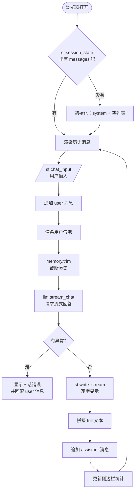

# P3 项目计划书 · 带记忆的聊天助手（Web 版）

> 难度：⭐⭐ ｜ 周期：一个周末（约 3 小时）｜ 学习模块：M2
> **采用的资料**：见文末第 7 节

---

## 1. 项目要做什么

### 一句话

把 P1 的命令行工具，升级成一个**在浏览器里打开、有打字机效果、能记住上下文、能一键清空**的聊天助手。

### 验收标准

- [ ] 浏览器能打开，界面像聊天软件
- [ ] 回答是**一个字一个字蹦出来**的（流式）
- [ ] 能连续聊 10 轮，且记得前面说过的话
- [ ] 左侧能看到"已用 token / 当前轮数"
- [ ] 有"清空对话"按钮，点了立刻失忆
- [ ] API 出错时，界面上显示**人话**提示，不是红色报错

### 明确不做

- ❌ 不做多用户登录
- ❌ 不做数据库持久化（刷新页面就没了，这版接受）
- ❌ 不做移动端适配
- ❌ 不接 RAG（那是 P5）

---

## 2. 工具与开发环境

> 🛑 **这次要装一个新东西：Streamlit。装之前跟我说一声。**

| 工具 | 状态 | 用途 | 安装 |
|---|---|---|---|
| Python 3.10+ | 已有 | 运行 | — |
| `openai` | P1 已装 | 调模型 | — |
| `python-dotenv` | P1 已装 | 读 Key | — |
| **`streamlit`** | **新增** | 网页界面 | `pip install streamlit` |

### 装完验证

```bash
streamlit --version
```

### 为什么选 Streamlit 而不是 Web 前端

| 方案 | 你需要写 | 时间 |
|---|---|---|
| HTML + JS + 后端 | 三种语言 + 接口设计 | 2 周 |
| **Streamlit** | **只用 Python** | **2 小时** |

Streamlit 的本质是：**你用 Python 描述界面，它自动帮你生成网页。** 每次代码保存，浏览器自动刷新。

> 它的定位是"数据应用原型"，不适合做正式产品。但**对你现在这个阶段，它是最优解**——你要学的是 AI，不是前端。

---

## 3. 项目文件结构

```
p3-chat/
├── .env
├── .gitignore
├── requirements.txt       ← 记录依赖，方便换电脑重装
├── config.py              ← 常量：模型名、窗口大小、系统提示词
├── memory.py              ← 历史管理：追加、截断、统计
├── llm.py                 ← 只负责调模型（含流式）
└── app.py                 ← 只负责界面
```

### 为什么这样拆（这版必须拆）

P1 只有一个文件就够了，因为只有 60 行。P3 会到 200 行以上，**再堆一个文件里你会改崩**。

| 文件 | 只干一件事 | 改什么时动它 |
|---|---|---|
| `config.py` | 存常量 | 换模型、调窗口大小 |
| `memory.py` | 管历史 | 改截断策略 |
| `llm.py` | 调 API | 换模型厂商、加参数 |
| `app.py` | 画界面 | 改 UI |

**这就是"关注点分离"。** 你以后看任何开源项目，先看它怎么分文件，比看代码本身有用。

---

## 4. 项目流程图



### 看懂这张图的两个关键

1. **`st.session_state` 是"记忆的容器"**。Streamlit 每次交互都会**重跑整个脚本**，普通变量会被重置，只有 `session_state` 里的东西能活下来。
2. **异常要回滚**。如果请求失败，用户那条消息不能留在历史里，否则下一轮模型会看到一个"没人回答的问题"。

---

## 5. 分步实现

### Step 1 · 装 Streamlit 并跑通空页面（15 分钟）

```bash
pip install streamlit
```

新建 `app.py`：

```python
import streamlit as st

st.set_page_config(page_title="小助", page_icon="🤖")
st.title("🤖 小助")
st.caption("一个会记住上下文的聊天助手")

st.chat_message("assistant").write("你好，我是小助。有什么可以帮你？")
```

运行：

```bash
streamlit run app.py
```

**会发生什么**：自动弹出浏览器，地址是 `http://localhost:8501`。

**验证**：能看到标题和一个灰色气泡。

**踩坑**：
- 端口被占用 → `streamlit run app.py --server.port 8502`
- 浏览器没自动打开 → 手动访问终端里打印的 URL

---

### Step 2 · 做出能输入、能显示的聊天框（25 分钟）

```python
import streamlit as st

st.set_page_config(page_title="小助", page_icon="🤖")
st.title("🤖 小助")

# ① 初始化记忆（只初始化一次）
if "messages" not in st.session_state:
    st.session_state.messages = [
        {"role": "system", "content": "你叫小助，说话简洁友好，回答不超过 150 字。"}
    ]

# ② 渲染历史（跳过 system，用户不该看见它）
for m in st.session_state.messages:
    if m["role"] == "system":
        continue
    with st.chat_message(m["role"]):
        st.write(m["content"])

# ③ 接收输入
if prompt := st.chat_input("说点什么…"):
    st.session_state.messages.append({"role": "user", "content": prompt})
    with st.chat_message("user"):
        st.write(prompt)

    # ④ 先假装回答（下一步换成真模型）
    with st.chat_message("assistant"):
        st.write(f"你说的是：{prompt}")
```

**验证**：输入一句话，能看到你的气泡和一个假回答。

**这一行很关键**：`if prompt := st.chat_input(...)` 用的是**海象运算符** `:=`，意思是"赋值并判断非空"。等价于：

```python
prompt = st.chat_input(...)
if prompt:
    ...
```

> 这个写法在 Streamlit 官方示例里到处都是，看不懂会卡住很多人。

---

### Step 3 · 接上真模型（30 分钟）

`llm.py`：

```python
import os
from dotenv import load_dotenv
from openai import OpenAI

load_dotenv()

client = OpenAI(
    api_key=os.getenv("DEEPSEEK_API_KEY"),
    base_url="https://api.deepseek.com",
)

MODEL = "deepseek-chat"


def stream_chat(messages, temperature=0.7):
    """生成器：逐块 yield 文本。"""
    stream = client.chat.completions.create(
        model=MODEL,
        messages=messages,
        temperature=temperature,
        stream=True,
    )
    for chunk in stream:
        if not chunk.choices:
            continue
        delta = chunk.choices[0].delta.content or ""
        if delta:
            yield delta
```

`app.py` 里替换第 ④ 步：

```python
from llm import stream_chat

    with st.chat_message("assistant"):
        full = st.write_stream(stream_chat(st.session_state.messages))

    st.session_state.messages.append({"role": "assistant", "content": full})
```

**两个要点**：

1. **`st.write_stream` 接受一个生成器**，会自动实现打字机效果。**不需要你手写循环。**
2. **它返回拼好的完整字符串**，所以能直接 `append` 回去。

**验证**：回答逐字出现，且有上下文（问"我叫什么"之前先告诉它名字）。

---

### Step 4 · 加截断（25 分钟）

`memory.py`：

```python
def trim(messages, max_turns=10):
    """保留 system + 最近 max_turns 轮。"""
    if not messages:
        return []

    if messages[0]["role"] == "system":
        system, history = [messages[0]], messages[1:]
    else:
        system, history = [], messages

    tail = []
    if history and history[-1]["role"] == "user":
        tail = [history[-1]]
        history = history[:-1]

    return system + history[-(max_turns * 2):] + tail


def count_tokens_rough(messages):
    """粗估 token：汉字约 1 token/字，英文约 0.25 token/字符。"""
    total = 0
    for m in messages:
        text = m["content"]
        cjk = sum(1 for ch in text if "\u4e00" <= ch <= "\u9fff")
        total += cjk + (len(text) - cjk) // 4 + 4   # +4 是每条消息的固定开销
    return total
```

`app.py` 里，在调模型前加一行：

```python
to_send = trim(st.session_state.messages, max_turns=10)
full = st.write_stream(stream_chat(to_send))
```

**注意**：`trim` 只作用于"发出去的内容"，**不要把 `session_state.messages` 覆盖掉**——否则用户往上一翻，发现历史消息莫名消失了。

> 这是本题最容易错的地方：**"我要发给模型的历史" ≠ "我要显示给用户的历史"。**

---

### Step 5 · 加侧边栏统计与清空（20 分钟）

```python
with st.sidebar:
    st.header("状态")
    st.metric("对话轮数", len(st.session_state.messages) // 2)
    st.metric("估算 token", count_tokens_rough(st.session_state.messages))
    st.metric("发送窗口", "最近 10 轮")

    if st.button("🗑️ 清空对话"):
        st.session_state.messages = [st.session_state.messages[0]]
        st.rerun()
```

**`st.rerun()` 必须加**。Streamlit 不会自动重跑，清空后界面还显示旧内容，用户会以为按钮坏了。

---

### Step 6 · 异常处理（25 分钟）

```python
from openai import APIError, APIConnectionError, AuthenticationError, RateLimitError

    try:
        with st.chat_message("assistant"):
            full = st.write_stream(stream_chat(to_send))
        st.session_state.messages.append({"role": "assistant", "content": full})
    except AuthenticationError:
        st.error("🔑 API Key 无效，请检查 .env 文件。")
        st.session_state.messages.pop()      # 回滚用户消息
    except RateLimitError:
        st.warning("⏳ 请求太频繁，请等几秒再试。")
        st.session_state.messages.pop()
    except APIConnectionError:
        st.error("🌐 网络连接失败，请检查网络。")
        st.session_state.messages.pop()
    except APIError as e:
        st.error(f"⚠️ 服务出错了：{e}")
        st.session_state.messages.pop()
```

**三个设计决策，值得你想一分钟**：

| 决策 | 为什么 |
|---|---|
| 出错时 `pop()` 回滚 | 否则历史里会留下"没人回答的问题"，下一轮模型会困惑 |
| 用 `st.error` 而不是 `print` | 界面上的错误要让用户看见，终端里的错误用户看不见 |
| 不把原始异常直接显示 | `Error code: 401 - {'error': {...}}` 用户看不懂 |

---

### Step 7 · 收尾（20 分钟）

**① 生成 `requirements.txt`**：

```bash
pip freeze > requirements.txt
```

或者手写（更干净）：

```
openai
python-dotenv
streamlit
```

**② 写 README.md**（三行就够）：

```markdown
# 小助 - 带记忆的聊天助手
启动：pip install -r requirements.txt && streamlit run app.py
需要：.env 里配置 DEEPSEEK_API_KEY
```

**③ 录一个 30 秒的屏幕录像**，展示打字机效果和"记住名字"。**这是你简历里能放的第一个 demo。**

---

## 6. 项目进化方向

| 等级 | 加什么 | 学什么 | 难度 |
|---|---|---|---|
| Lv.1 | 侧边栏加 `temperature` 滑块 | Streamlit 控件 | ⭐ |
| Lv.2 | 多会话（左侧列表，可切换） | `session_state` 嵌套结构 | ⭐⭐ |
| Lv.3 | 对话存 SQLite，刷新不丢 | sqlite3 | ⭐⭐⭐ |
| Lv.4 | 支持上传文件问答 | 文件解析 + RAG | ⭐⭐⭐⭐（→ P5） |
| Lv.5 | 加"重新生成"按钮 | 保留 messages 快照 | ⭐⭐ |
| Lv.6 | 支持切换模型（DeepSeek / 通义） | 工厂模式 | ⭐⭐⭐ |

### 三个"看起来该做但其实先别做"的

| 想法 | 为什么先别做 |
|---|---|
| 加登录注册 | 你要学的是 AI，不是 auth。用的人只有你自己 |
| 换成 React 前端 | 会吃掉你 2 个周末，且对找 AI 岗没有加分 |
| 接入微信 | 封号风险 + 和 AI 无关 |

---

## 7. 本项目采用的资料

| 步骤 | 参考 | 出处 |
|---|---|---|
| Step 1–2 界面 | Streamlit 官方文档 Get started | https://docs.streamlit.io/ |
| Step 2 `chat_input` | Streamlit API · `st.chat_input` / `st.chat_message` | https://docs.streamlit.io/develop/api-reference/chat |
| Step 3 流式 | OpenAI Cookbook · streaming 示例 | https://github.com/openai/openai-cookbook |
| Step 3 流式 | DeepSeek 文档 · `stream` 参数 | https://api-docs.deepseek.com/zh-cn/ |
| Step 4 截断 | llm-universe 第 3 章 | https://datawhalechina.github.io/llm-universe/ |
| Step 4 截断 | 本讲稿第三节（四种策略） | 本地 |
| Step 6 异常 | OpenAI SDK 异常类定义 | https://github.com/openai/openai-python |

---

## 交付清单

- [ ] `streamlit run app.py` 能起来，浏览器能聊
- [ ] 打字机效果正常
- [ ] 说"我叫李雷"，隔 3 轮问"我叫什么"，能答对
- [ ] 侧边栏数字会随对话变化
- [ ] 清空按钮有效
- [ ] 故意把 Key 改错，界面显示"🔑 API Key 无效"而不是红色堆栈
- [ ] 30 秒 demo 录像

> 做完这个，你就有了**一个能发给朋友看的东西**。
> 别人的项目还停留在命令行，你已经能发链接了——这个心理落差，会推着你往下走。
