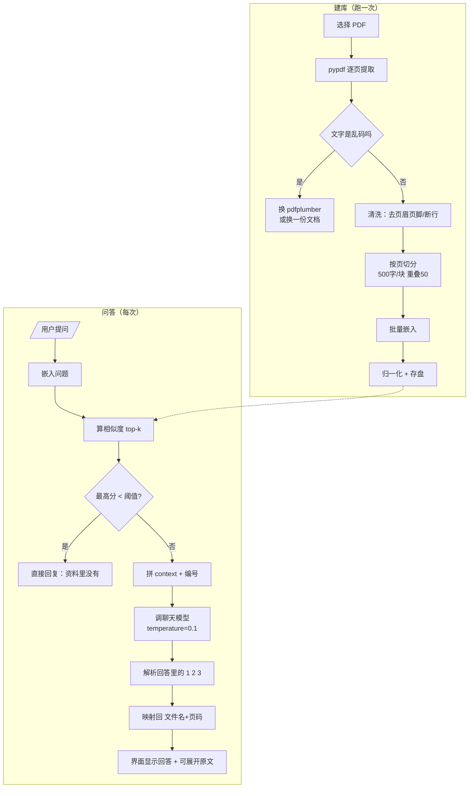

# P5 项目计划书 · 个人文档问答机器人 v1

> 难度：⭐⭐⭐ ｜ 周期：两个周末（约 5 小时）｜ 学习模块：M4
> **这是你第一个能写进简历的项目。**
> **采用的资料**：见文末第 7 节

---

## 1. 项目要做什么

### 一句话

上传一份 PDF，然后**用大白话问它问题**，它从文档里找答案，并告诉你**答案在第几页**。

### 验收标准

- [ ] 能解析一份 10 页以上的中文 PDF
- [ ] 建索引一次，之后提问不用重建
- [ ] 问文档里有的问题，能答对，且**引用到正确页码**
- [ ] 问文档里**没有**的问题，会说"根据现有资料无法回答"
- [ ] 界面能看到"检索到了哪 3 段"，方便你自己调试
- [ ] 有一份 10 题的评测记录（对几题、错在哪）

### 明确不做

- ❌ 不做多文档同时检索（v2 再说）
- ❌ 不做切分策略自动选择（手动调参）
- ❌ 不做重排、查询改写（**M5 的内容**）
- ❌ 不做用户系统、不做部署（M7）

> **v1 的目标是"跑通并诚实"**：能答就答，不能答就说不能答，且每个答案有出处。

---

## 2. 工具与开发环境

> 🛑 **这次要装 `pypdf`，装之前跟我说一声。**

| 项 | 状态 | 说明 |
|---|---|---|
| Python 3.10+ | 已有 | — |
| `pypdf` | **新增** | PDF 解析，`pip install pypdf`，纯 Python，无需编译 |
| `numpy` | P4 已装 | 向量计算 |
| `openai` | 已有 | 聊天 + embedding |
| `streamlit` | P3 已装 | 界面 |
| embedding 服务 | P4 已注册 | 沿用 |
| 聊天服务 | 已有 | DeepSeek |

### 为什么用 `pypdf` 而不是 `PyMuPDF` / `pdfplumber`

| 库 | 优点 | 缺点 | 适合 |
|---|---|---|---|
| **pypdf** | 纯 Python、好装、够用 | 复杂排版（双栏、表格）效果差 | **入门** |
| pdfplumber | 表格解析强 | 慢、依赖多 | 表格多的文档 |
| PyMuPDF (fitz) | 快、质量好 | 要装二进制包，有时报错 | 生产环境 |
| MinerU / Marker | 版面还原极好 | 要下模型、吃显存 | 专业文档处理 |

> **先用 pypdf 把流程跑通。** 如果解析出来的文字是乱码或错位，再换 `pdfplumber`——**但那时你已经知道问题在哪了**。

---

## 3. 项目文件结构

```
p5-rag/
├── .env
├── .gitignore
├── requirements.txt
├── config.py          ← 参数集中管理（chunk_size 等）
├── loader.py          ← PDF → 带页码的文本
├── splitter.py        ← 清洗 + 切分
├── embedder.py        ← 文本 → 向量
├── store.py           ← 索引存/读（chunks.json + vectors.npy）
├── rag.py             ← 检索 + 拼提示词 + 生成
├── app.py             ← Streamlit 界面
├── data/
│   └── 售后政策.pdf
└── index/
    ├── chunks.json
    └── vectors.npy
```

### 为什么索引要存成两个文件

| 文件 | 存什么 | 为什么分开 |
|---|---|---|
| `chunks.json` | 文本 + 元数据（页码、来源） | 人可读，方便你直接打开看"切成了什么样" |
| `vectors.npy` | 纯数值矩阵 | `numpy` 原生格式，读取快，体积小 |

**分开的原因**：调试时你只想看文本（json 能直接读），不想看十万个浮点数。

> 这是工程上的常见做法：**"人能读的"和"机器要算的"分开存。**

---

## 4. 项目流程图



### 三个关键设计点

1. **建库和问答完全解耦**：建库慢（要读 PDF、算向量），只做一次；问答快。
2. **阈值前置**：检索分数太低就直接拒答，**根本不调聊天模型**——省钱且不会编。
3. **引用是"后处理"**：先让模型带编号输出，再把编号映射回页码。**不要让模型自己写页码**（它会写错）。

---

## 5. 分步实现

### Step 0 · 选一份"好"的 PDF（20 分钟，别跳过）

**这一步决定你后面三小时的体验。**

#### 好的文档长什么样

| ✅ 好 | ❌ 差 |
|---|---|
| 文字版 PDF（能选中复制） | 扫描件（图片，需要 OCR） |
| 单栏排版 | 双栏、多栏混排 |
| 有明确条款/步骤 | 大量复杂表格、公式 |
| 你自己熟悉内容 | 完全陌生的领域（你没法判断它对不对） |

**推荐素材**：产品说明书、课程讲义、政策文件、你自己的学习笔记导出。

#### 怎么快速判断

用 Edge 打开 PDF，**试着用鼠标选中一段文字并复制**：

- 能选中、粘贴出来是正常中文 → ✅ 可以用
- 选中是空白 / 粘贴出来是乱码 → ❌ 这是扫描件，需要 OCR（先别碰）

---

### Step 1 · 装 pypdf，先验证解析质量（30 分钟）

```bash
pip install pypdf
```

**在做任何其他事之前，先看一眼解析结果**：

```python
# 临时脚本 check.py
from pypdf import PdfReader

reader = PdfReader("data/售后政策.pdf")
print("总页数：", len(reader.pages))
for i in range(min(3, len(reader.pages))):
    print(f"\n===== 第 {i+1} 页 =====")
    print(reader.pages[i].extract_text()[:500])
```

**你必须亲眼确认三件事**：

1. 有没有文字？（没有 → 扫描件，换文档）
2. 中文是不是乱码？（是 → 编码问题，换 pdfplumber）
3. **段落顺序对不对？**（双栏 PDF 会把左右栏交错读出来，变成"天书"）

> **这一步花 10 分钟，能省你后面 2 小时。**
> 90% 的人跳过这一步，然后在"为什么 RAG 答得乱七八糟"上卡一整天——其实是因为**输入本来就是乱的**。

---

### Step 2 · 写 `loader.py`：逐页提取（20 分钟）

```python
from pypdf import PdfReader


def load_pdf(path: str):
    """返回 [{"page": 1, "text": "..."}, ...]"""
    reader = PdfReader(path)
    pages = []
    for i, page in enumerate(reader.pages, start=1):
        try:
            text = page.extract_text() or ""
        except Exception as e:
            print(f"⚠️ 第 {i} 页解析失败：{e}")
            text = ""
        pages.append({"page": i, "text": text})
    return pages
```

**为什么要逐页保留**：因为**页码是引用的基础**。整本读成一坨，你就永远不知道答案在第几页。

**为什么 `try/except`**：PDF 里偶尔有损坏的页，一页报错不该让整个程序崩。

---

### Step 3 · 写 `splitter.py`：清洗 + 切分（40 分钟，最需要动脑）

```python
import re


def clean(text: str) -> str:
    # 1. 去掉连续空行
    text = re.sub(r"\n{3,}", "\n\n", text)

    # 2. PDF 每行硬换行 → 合并成段（保留真正的段落分隔 \n\n）
    text = re.sub(r"(?<!\n)\n(?!\n)", "", text)

    # 3. 去掉行内多余空格
    text = re.sub(r"[ \t]{2,}", " ", text)

    # 4. 去掉常见的页眉页脚残留（按你文档的实际情况改）
    text = re.sub(r"^\s*第\s*\d+\s*页\s*$", "", text, flags=re.M)
    text = re.sub(r"^\s*-?\s*\d+\s*-?\s*$", "", text, flags=re.M)

    return text.strip()


def split_pages(pages, doc_name: str, chunk_size=500, overlap=50):
    """按页切分，保留页码。"""
    chunks = []
    for p in pages:
        text = clean(p["text"])
        if len(text) < 30:           # 太短的页（封面、目录）跳过
            continue

        start, idx = 0, 0
        while start < len(text):
            piece = text[start:start + chunk_size]
            if piece.strip():
                chunks.append({
                    "id": f"{doc_name}_p{p['page']}_c{idx}",
                    "text": piece,
                    "source": doc_name,
                    "page": p["page"],
                    "chunk_index": idx,
                })
                idx += 1
            start += chunk_size - overlap
    return chunks
```

#### 这段代码里有三个决定成败的细节

| 细节 | 不做的后果 |
|---|---|
| **`(?<!\n)\n(?!\n)` 合并单换行** | PDF 每行都硬换行，不合并的话"退款需要 3-5 个工"和"作日到账"会被算成两句，向量表示被割裂 |
| **按页切，不跨页** | 跨页的块无法标注单一页码，引用就废了 |
| **`len(text) < 30` 跳过** | 封面、目录页会产生一堆"第 1 页""目录"这种垃圾块，污染检索 |

> **`(?<!\n)\n(?!\n)` 是什么**：正则的"前后瞻"。意思是"这个 `\n` 前面不是 `\n`，后面也不是 `\n`"——也就是**只匹配孤立的单换行**，保留段落之间的双换行。
> 不用看懂语法，会用就行。

---

### Step 4 · 写 `embedder.py`（15 分钟，直接复用 P4）

```python
import numpy as np
from openai import OpenAI

from config import BATCH_SIZE, EMBED_API_KEY, EMBED_BASE_URL, EMBED_MODEL

client = OpenAI(api_key=EMBED_API_KEY, base_url=EMBED_BASE_URL)


def embed_texts(texts):
    out = []
    for i in range(0, len(texts), BATCH_SIZE):
        resp = client.embeddings.create(model=EMBED_MODEL, input=texts[i:i + BATCH_SIZE])
        out.extend([d.embedding for d in sorted(resp.data, key=lambda x: x.index)])
    return out


def normalize(v):
    v = np.asarray(v, dtype=np.float32)
    return v / (np.linalg.norm(v) + 1e-10)
```

---

### Step 5 · 写 `store.py`：把索引存下来（30 分钟）

```python
import json
import os

import numpy as np

from config import CHUNKS_PATH, VECTORS_PATH, EMBED_MODEL


def save(chunks, vecs):
    os.makedirs(os.path.dirname(CHUNKS_PATH), exist_ok=True)
    with open(CHUNKS_PATH, "w", encoding="utf-8") as f:
        json.dump({"model": EMBED_MODEL, "chunks": chunks}, f, ensure_ascii=False)
    np.save(VECTORS_PATH, np.array(vecs, dtype=np.float32))
    print(f"✅ 已保存 {len(chunks)} 个块")


def load():
    if not (os.path.exists(CHUNKS_PATH) and os.path.exists(VECTORS_PATH)):
        return None, None

    with open(CHUNKS_PATH, encoding="utf-8") as f:
        data = json.load(f)

    if data["model"] != EMBED_MODEL:
        print(f"⚠️ 索引模型是 {data['model']}，当前是 {EMBED_MODEL}，请重建")
        return None, None

    return data["chunks"], np.load(VECTORS_PATH)
```

**`np.save` / `np.load`** 是 numpy 的二进制格式，比 json 存浮点数**小 5~10 倍，快几十倍**。

---

### Step 6 · 写 `rag.py`：检索 + 生成（50 分钟，核心）

```python
import re

import numpy as np
from openai import OpenAI

from config import (CHAT_API_KEY, CHAT_BASE_URL, CHAT_MODEL,
                    DEFAULT_THRESHOLD, DEFAULT_TOP_K)
from embedder import embed_texts, normalize

chat_client = OpenAI(api_key=CHAT_API_KEY, base_url=CHAT_BASE_URL)

RAG_TEMPLATE = """你是一个严谨的文档问答助手。请只根据下面提供的资料回答问题。

规则：
1. 只能使用资料中的信息，不要使用你自己的知识。
2. 每个结论后用 [编号] 标注来源，例如 [1]。
3. 如果资料里没有足够信息，直接回答"根据现有资料无法回答"，不要猜测。
4. 回答简洁，不超过 200 字。

资料：
{context}

问题：{question}"""


def retrieve(question, chunks, matrix, k=DEFAULT_TOP_K):
    qv = normalize(embed_texts([question])[0])
    scores = matrix @ qv
    order = np.argsort(-scores)[:k]
    return [{**chunks[i], "score": float(scores[i])} for i in order]


def build_context(hits):
    lines, refs = [], {}
    for i, h in enumerate(hits, start=1):
        tag = f"[{i}]"
        lines.append(f"{tag} {h['text']}")
        refs[tag] = {"source": h["source"], "page": h["page"], "score": h["score"]}
    return "\n\n".join(lines), refs


def answer(question, chunks, matrix, k=DEFAULT_TOP_K, threshold=DEFAULT_THRESHOLD):
    hits = retrieve(question, chunks, matrix, k)
    best = hits[0]["score"] if hits else 0.0

    if best < threshold:
        return "根据现有资料无法回答。", [], best

    context, refs = build_context(hits)
    prompt = RAG_TEMPLATE.format(context=context, question=question)

    resp = chat_client.chat.completions.create(
        model=CHAT_MODEL,
        messages=[{"role": "user", "content": prompt}],
        temperature=0.1,          # 事实性任务，要稳
    )
    return resp.choices[0].message.content, refs, best
```

#### 四个参数选择，每个都有理由

| 参数 | 值 | 为什么 |
|---|---|---|
| `temperature` | **0.1** | 事实问答要稳。0.7 会让它"发挥" |
| `k` | **3** | 3 段够用；10 段会让模型分心 |
| `threshold` | **0.5**（起点） | 需要你实测调 |
| 编号 | **从 1 开始** | 和提示词对齐，偏移一位会导致引用全错 |

---

### Step 7 · 写 `app.py`：界面 + 展示引用（40 分钟）

```python
import streamlit as st

from rag import answer
from store import load

st.set_page_config(page_title="文档问答", page_icon="📄")
st.title("📄 文档问答机器人")
st.caption("答案来自你的 PDF，带页码出处")

chunks, matrix = load()
if chunks is None:
    st.error("索引不存在，请先运行 `python build.py` 建库。")
    st.stop()

with st.sidebar:
    k = st.slider("检索段数", 1, 8, 3)
    th = st.slider("相似度阈值", 0.0, 1.0, 0.5, 0.01)
    st.caption(f"库里有 {len(chunks)} 个文本块")

q = st.text_input("问点什么", placeholder="例如：退款多久到账？")

if q:
    text, refs, best = answer(q, chunks, matrix, k=k, threshold=th)

    st.markdown(text)

    if refs:
        st.divider()
        st.caption(f"检索最高分：{best:.3f}")
        with st.expander("📚 查看引用的原文"):
            for tag, info in refs.items():
                st.markdown(f"**{tag}** {info['source']} · 第 {info['page']} 页 · 相似度 {info['score']:.3f}")
```

**`st.expander` 是点睛之笔**：默认折叠，用户想看再展开。

这个设计让你既能"看起来简洁"，又能"随时自证"。**面试时点开这个，比说十句都有用。**

---

### Step 8 · 建库脚本 + 首次运行（20 分钟）

```python
# build.py
from config import CHUNK_OVERLAP, CHUNK_SIZE, DOC_NAME, DOC_PATH
from embedder import embed_texts, normalize
from loader import load_pdf
from splitter import split_pages
from store import save

if __name__ == "__main__":
    pages = load_pdf(DOC_PATH)
    print(f"解析到 {len(pages)} 页")

    chunks = split_pages(pages, DOC_NAME, CHUNK_SIZE, CHUNK_OVERLAP)
    print(f"切成 {len(chunks)} 块")

    vecs = [normalize(v).tolist() for v in embed_texts([c["text"] for c in chunks])]
    save(chunks, vecs)
```

```bash
python build.py     # 建库
streamlit run app.py
```

---

### Step 9 · 评测（40 分钟，**决定你是"做过"还是"做好了"**）

建 `eval.md`，填 10 题：

| # | 问题 | 类型 | 检索对? | 回答对? | 引用对? | 备注 |
|---|---|---|---|---|---|---|
| 1 | 文档里直接写了的 | 简单 | | | | |
| 2 | 需要跨两页 | 中等 | | | | |
| 3 | 换个说法问 | 同义 | | | | |
| 4 | 文档里没有 | 拒答 | | | | |
| 5 | 问一个数字 | 精确 | | | | |
| ... | | | | | | |

然后算三个数：

```
检索命中率 = 检索对的题数 / 10
回答正确率 = 回答对的题数 / 10
引用正确率 = 引用对的题数 / 10
```

> **这三个数就是你的项目"成绩单"。** 没有它们的项目，在面试里只能算"练习"。

---

### Step 10 · 调参实验（30 分钟，产出你的"结论"）

用同一个评测集，跑 4 组参数：

| chunk_size | k | 检索命中率 | 回答正确率 | 平均 token |
|---|---|---|---|---|
| 300 | 3 | | | |
| 500 | 3 | | | |
| 500 | 5 | | | |
| 800 | 3 | | | |

**然后写一段 100 字结论**，例如：

> chunk_size=500/k=3 综合最好（命中 8/10，回答 7/10）。300 时命中 7/10 但回答掉到 5/10——切太碎导致答案不完整。k=5 时回答反而变差（6/10），因为无关块干扰。结论：**这个文档适合"中等块 + 少召回"**。

> **这段话就是你简历里可以写的那句"我的 RAG 命中率 80%，通过调切分参数从 70% 提上来"。**

---

## 6. 项目进化方向

| 等级 | 加什么 | 学什么 | 难度 |
|---|---|---|---|
| Lv.1 | 支持多个 PDF（文件名进元数据） | 索引合并 | ⭐⭐ |
| Lv.2 | 加"父子块"（小块检索、大块生成） | 两级索引 | ⭐⭐⭐ |
| Lv.3 | 加混合检索（关键词 + 向量） | BM25 | ⭐⭐⭐（M5） |
| Lv.4 | 加查询改写（先让模型改写问题） | Query Rewriting | ⭐⭐⭐（M5） |
| Lv.5 | 加重排（rerank） | Cross-encoder | ⭐⭐⭐⭐（M5） |
| Lv.6 | 支持 Word/网页/Excel | 多格式解析 | ⭐⭐⭐ |
| Lv.7 | 答案高亮原文（在 PDF 里标出那句话） | 前端 + 定位 | ⭐⭐⭐⭐ |

### 三个"先别做"的

| 想法 | 为什么先别做 |
|---|---|
| 支持 100 份 PDF | 你的瓶颈不在"量"，在"一份都答不准" |
| 加聊天式多轮追问 | 会引入"指代消解"难题，M5 再说 |
| 换更贵的模型 | 先确认是检索的问题还是生成的问题（十有八九是检索） |

---

## 7. 本项目采用的资料

| 步骤 | 参考 | 出处 |
|---|---|---|
| Step 0–2 PDF 解析 | pypdf 官方文档 | https://pypdf.readthedocs.io/ |
| Step 3 清洗与切分 | all-in-rag · 文档解析与切分章节 | https://datawhalechina.github.io/all-in-rag/ |
| Step 3 切分策略 | llm-universe 第 5 章 | https://datawhalechina.github.io/llm-universe/ |
| Step 5 索引存储 | 本讲稿第三节 | 本地 |
| Step 6 RAG 提示词 | 复旦《大规模语言模型》第 7 章 | https://llmbook-zh.github.io/ |
| Step 6 提示词模板 | all-in-rag · 生成章节 | https://datawhalechina.github.io/all-in-rag/ |
| Step 7 界面 | Streamlit 文档 | https://docs.streamlit.io/ |
| Step 9–10 评测 | all-in-rag · 评估章节（预习 M5） | https://datawhalechina.github.io/all-in-rag/ |

---

## 交付清单

- [ ] `python build.py` 能建库，打印页数/块数
- [ ] 5 类问题都能处理，包括"拒答"
- [ ] 引用能定位到**具体页码**
- [ ] 界面上"查看引用原文"能展开
- [ ] `eval.md` 填了 10 题，算了 3 个率
- [ ] 调参实验表填了 4 组
- [ ] 写了 100 字结论

> 做完这个，你的简历可以写第一行了：
> **"独立实现基于向量检索的文档问答系统（pypdf + Embedding + 自建索引），10 题评测命中率 80%，通过切分参数调优提升 10 个百分点。"**
>
> 这句话，比"熟悉 Python"值钱一百倍。
