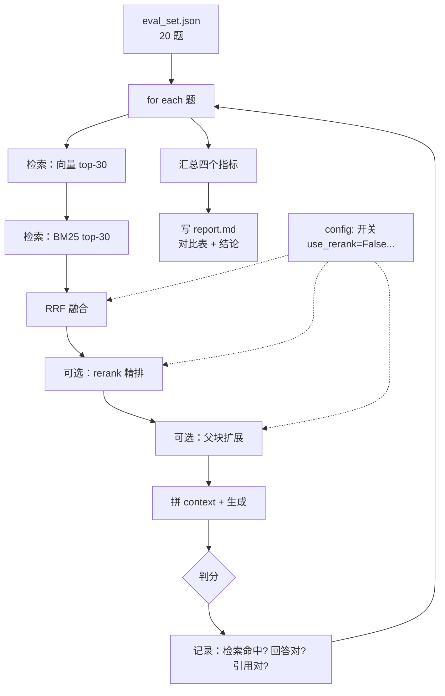

# P6 项目计划书 · 带评测的 RAG v2

> 难度：⭐⭐⭐⭐ ｜ 周期：两个周末（约 6 小时）｜ 学习模块：M5
> **这是你简历里最有分量的一行。**
> **采用的资料**：见文末第 7 节

---

## 1. 项目要做什么

### 一句话

给 P5 装一个"体检仪"：建 20 题评测集，量出四个指标，然后**用数据驱动地做 3 次优化**，最后拿出一张"62% → 81%"的对比表。

### 为什么这个项目比 P5 值钱

| P5 能证明 | P6 能证明 |
|---|---|
| 你会搭 RAG | 你会**衡量** RAG |
| "我做了个问答机器人" | "我把命中率从 62% 提到 81%" |
| 面试官：哦 | 面试官：**怎么提的？** ← 这才是面试开始的地方 |

### 验收标准

- [ ] 20 题评测集，含 gold_ids 和"应拒答"题
- [ ] 一条命令跑完评测，输出 4 个指标
- [ ] 有**基线数字**（改动前的）
- [ ] 至少做 **2 次优化**，每次只改一处
- [ ] 有对比表 + 200 字归因结论
- [ ] 能找出"所有版本都错"的题，并分析原因

### 明确不做

- ❌ 不做微调 rerank 模型
- ❌ 不做多文档、不做部署
- ❌ 不追求 SOTA，**追求"可解释的提升"**

---

## 2. 工具与开发环境

> 🛑 **本项目的核心优化（父块 + 混合检索）零新增依赖。**
> rerank 是可选项，要装模型/开 API，**动手前先问我。**

| 项 | 状态 | 说明 |
|---|---|---|
| Python + numpy + streamlit | 已有 | 沿用 P5 |
| **`jieba`** | **可选** | 中文分词。**先别装**，本项目用"字符 bigram"替代 |
| `sentence-transformers` | **可选** | 本地 rerank，要下模型 |
| rerank API | **可选** | 如 Cohere / Jina / 国内厂商 |
| `matplotlib` | 可选 | 画对比柱状图 |

### 为什么先用"字符 bigram"做 BM25

中文没有空格，做 BM25 要先分词。但分词有两个问题：

1. 要装 `jieba`（多一个依赖）
2. 分词错误会直接毁掉检索（"退款流程"被切成"退款/流程"还好，被切成"退/款流/程"就完了）

**字符 bigram 是个聪明的偷懒办法**：把"退款流程"切成 `退款`、`款流`、`流程`。不依赖词典，对中文效果还不错。

```python
def bigrams(text):
    text = "".join(text.split())       # 去掉所有空白
    return [text[i:i+2] for i in range(len(text) - 1)] if len(text) > 1 else [text]
```

> 这不是最优解，但它是"零依赖、够用、可解释"的解。**工程上"够用"比"最优"重要。**

---

## 3. 项目文件结构

在 P5 基础上新增 4 个文件：

```
p6-rag-v2/
├── （P5 的全部文件）
├── eval_set.json      ← 20 题评测集（核心资产）
├── evaluate.py        ← 跑评测、算指标、出报告
├── hybrid.py          ← BM25 + RRF 融合
├── expand.py          ← 父块扩展
├── rerank.py          ← 可选：重排
└── report.md          ← 你的优化报告（面试时可展示）
```

### 每个新文件的作用

| 文件 | 职责 | 为什么单独 |
|---|---|---|
| `eval_set.json` | 题库 + 标准答案 + gold_ids | **这是资产，要像代码一样版本管理** |
| `evaluate.py` | 只负责"跑题、判分、汇总" | 评测逻辑和业务逻辑分离 |
| `hybrid.py` | BM25 + 向量 + RRF | 一个检索策略一个文件 |
| `expand.py` | 命中后扩上下文 | 纯后处理，可插拔 |
| `rerank.py` | 精排 | 可开关，方便 A/B |

> **可插拔是关键**：每个优化都要能"关掉"，否则你没法做对比实验。

---

## 4. 项目流程图



### 关键设计：`config` 里的开关

```python
USE_HYBRID = True
USE_RERANK = False
USE_EXPAND = True
```

**每次实验只改一个开关，跑一遍，记录。** 这就是"控制变量法"。

---

## 5. 分步实现

### Step 1 · 建 20 题评测集（60 分钟，**最花时间但最值**）

`eval_set.json`：

```json
[
  {
    "id": "q01",
    "q": "退款多久能到账？",
    "type": "简单",
    "gold_ids": ["售后政策_p3_c0"],
    "gold_answer": "3-5 个工作日原路退回",
    "should_refuse": false
  },
  {
    "id": "q02",
    "q": "东西收到就坏了，能换吗？",
    "type": "同义",
    "gold_ids": ["售后政策_p2_c1"],
    "gold_answer": "质量问题支持 7 天无理由退换",
    "should_refuse": false
  },
  {
    "id": "q18",
    "q": "你们支持花呗分期吗？",
    "type": "拒答",
    "gold_ids": [],
    "gold_answer": "",
    "should_refuse": true
  }
]
```

#### 怎么找 `gold_ids`（这一步有技巧）

1. 先跑一遍检索（top-10），把结果打印出来
2. **人工看**哪一条真正包含答案
3. 把那条的 `id` 填进去

```python
# 找 gold 的小工具
for q in ["退款多久能到账？", "怎么开发票", ...]:
    print("=" * 40)
    print(q)
    for h in retrieve(q, chunks, matrix, k=10):
        print(f"  {h['id']}  {h['score']:.3f}  {h['text'][:50]}")
```

> **注意**：如果 top-10 里**都没有**能回答的块，说明这道题"库里没有"，它应该被改成"拒答题"，或者你的切分真的有问题。**这个发现本身就很有价值。**

#### 20 题的配比（照抄这张表）

| 类型 | 数量 | 编号 |
|---|---|---|
| 简单事实 | 6 | q01–q06 |
| 同义改写 | 5 | q07–q11 |
| 跨段/跨页 | 4 | q12–q15 |
| 精确信息（数字/编号） | 3 | q16–q18 |
| 应拒答 | 2 | q19–q20 |

---

### Step 2 · 写 `evaluate.py`（60 分钟）

```python
import json

from config import DEFAULT_TOP_K
from rag import answer, retrieve


def load_cases(path="eval_set.json"):
    with open(path, encoding="utf-8") as f:
        return json.load(f)


def judge_text(ans: str, gold: str) -> bool:
    """极简判分：看关键数字/关键词是否出现。
    生产环境要人工判或用 LLM 判，这里给初学者一个可跑的版本。"""
    if not gold:
        return False
    keys = [k for k in gold.replace("，", " ").split() if len(k) >= 2]
    return all(k in ans for k in keys) if keys else (gold in ans)


def evaluate(chunks, matrix, cases=None, k=DEFAULT_TOP_K, verbose=True):
    cases = cases or load_cases()
    n = len(cases)
    stats = {"recall": 0, "prec_sum": 0.0, "correct": 0,
             "refuse_total": 0, "refuse_ok": 0, "detail": []}

    for c in cases:
        hits = retrieve(c["q"], chunks, matrix, k=k)
        ids = [h["id"] for h in hits]

        # --- 检索指标 ---
        if c["should_refuse"]:
            recall_ok = True          # 拒答题不参与召回统计
        else:
            recall_ok = any(g in ids for g in c["gold_ids"])
            stats["recall"] += int(recall_ok)

            rel = sum(1 for i in ids if i in c["gold_ids"])
            stats["prec_sum"] += rel / max(1, len(ids))

        # --- 生成指标 ---
        text, refs, best = answer(c["q"], chunks, matrix, k=k)

        if c["should_refuse"]:
            stats["refuse_total"] += 1
            refused = ("无法回答" in text) or ("没有" in text) or ("未提及" in text)
            stats["refuse_ok"] += int(refused)
            ok = refused
        else:
            ok = judge_text(text, c["gold_answer"])
            stats["correct"] += int(ok)

        stats["detail"].append({
            "id": c["id"], "type": c["type"], "q": c["q"],
            "retrieval_ok": recall_ok, "answer_ok": ok,
            "best_score": round(best, 3), "hits": ids, "answer": text,
        })

        if verbose:
            mark = "✅" if ok else "❌"
            print(f"{mark} [{c['id']}][{c['type']}] {c['q']}  (最高分 {best:.3f})")

    answerable = n - stats["refuse_total"]
    return {
        "Recall@k": stats["recall"] / max(1, answerable),
        "Precision@k": stats["prec_sum"] / max(1, answerable),
        "答对率": stats["correct"] / max(1, answerable),
        "拒答正确率": stats["refuse_ok"] / max(1, stats["refuse_total"]),
        "明细": stats["detail"],
    }
```

#### 三个设计要点

| 要点 | 为什么 |
|---|---|
| **拒答题不参与 Recall 统计** | 它本来就没有 gold，算进去会把 Recall 人为拉低 |
| **`judge_text` 只做关键词匹配** | 简单粗糙，但**能跑、能复现**。别一开始就追求"完美判分" |
| **保存 `detail`** | 之后要按类型分组分析（"跨页题全错"这种洞察只能从明细里来） |

> ⚠️ `judge_text` 的粗糙是**故意的**。它会有误判——但**误判是稳定发生的**，所以你比较两个版本时，误差会抵消一部分。**先用粗糙指标跑起来，比用完美指标跑不起来强。**

---

### Step 3 · 跑基线（20 分钟）

```bash
python -c "
from store import load
from evaluate import evaluate
chunks, matrix = load()
r = evaluate(chunks, matrix)
for k, v in r.items():
    if k != '明细': print(f'{k}: {v:.2%}')
"
```

**把四个数字抄进 `report.md`。这就是你的基线。**

> 如果基线低得离谱（比如 Recall 0.3），**先别急着优化**——多半是 `gold_ids` 标错了，或者索引坏了。

---

### Step 4 · 优化一：父块扩展（30 分钟，零成本）

**思路**：命中块 `p3_c1` 后，把 `p3_c0` 和 `p3_c2` 一起给模型。

`expand.py`：

```python
def expand_hits(hits, chunks, window=1):
    """把命中块前后各 window 个同页块也加进来。"""
    by_page = {}
    for c in chunks:
        by_page.setdefault((c["source"], c["page"]), []).append(c)

    for v in by_page.values():
        v.sort(key=lambda x: x["chunk_index"])

    out, seen = [], set()
    for h in hits:
        key = (h["source"], h["page"])
        siblings = by_page.get(key, [])
        idxs = [s["chunk_index"] for s in siblings]
        if h["chunk_index"] not in idxs:
            out.append(h); seen.add(h["id"]); continue

        pos = idxs.index(h["chunk_index"])
        for j in range(max(0, pos - window), min(len(siblings), pos + window + 1)):
            s = siblings[j]
            if s["id"] not in seen:
                out.append({**s, "score": h["score"]})
                seen.add(s["id"])
    return out
```

**在 `rag.py` 里，检索后加一行**：

```python
if USE_EXPAND:
    hits = expand_hits(hits, chunks, window=1)
```

**跑评测，对比。**

**预期效果**：跨段题（q12–q15）答对率上升，token 成本上升约 2~3 倍。

> **如果变差了怎么办**：把 `window` 从 1 降到 0（等于关闭），或者只对"跨段类型"的题启用。**这就是为什么要有开关。**

---

### Step 5 · 优化二：混合检索（60 分钟，收益最大）

`hybrid.py`：

```python
import math
from collections import Counter


def bigrams(text):
    t = "".join(text.split())
    return [t[i:i + 2] for i in range(len(t) - 1)] if len(t) > 1 else [t]


class BM25:
    def __init__(self, docs, k1=1.5, b=0.75):
        self.docs = docs
        self.tokens = [bigrams(d["text"]) for d in docs]
        self.k1, self.b = k1, b
        self.N = len(docs)
        self.avgdl = sum(len(t) for t in self.tokens) / max(1, self.N)
        self.df = Counter()
        for toks in self.tokens:
            for w in set(toks):
                self.df[w] += 1

    def _idf(self, w):
        n = self.df.get(w, 0)
        return math.log(1 + (self.N - n + 0.5) / (n + 0.5))

    def search(self, query, k=30):
        q = bigrams(query)
        scores = []
        for i, toks in enumerate(self.tokens):
            tf = Counter(toks)
            dl = len(toks)
            s = 0.0
            for w in q:
                if w not in tf:
                    continue
                f = tf[w]
                s += self._idf(w) * f * (self.k1 + 1) / (
                    f + self.k1 * (1 - self.b + self.b * dl / max(1, self.avgdl))
                )
            scores.append((i, s))
        scores.sort(key=lambda x: -x[1])
        return [(self.docs[i]["id"], s) for i, s in scores[:k] if s > 0]


def rrf(*rank_lists, k=60):
    score = {}
    for ids in rank_lists:
        for rank, doc_id in enumerate(ids, start=1):
            score[doc_id] = score.get(doc_id, 0.0) + 1.0 / (k + rank)
    return sorted(score.items(), key=lambda x: -x[1])
```

**在 `rag.py` 的 `retrieve` 里改成**：

```python
def retrieve_hybrid(question, chunks, matrix, bm25, k=3, pool=30):
    qv = normalize(embed_texts([question])[0])
    vec_scores = matrix @ qv
    vec_ids = [chunks[i]["id"] for i in np.argsort(-vec_scores)[:pool]]

    bm25_ids = [doc_id for doc_id, _ in bm25.search(question, k=pool)]

    fused = rrf(vec_ids, bm25_ids)[:k]
    by_id = {c["id"]: c for c in chunks}
    return [by_id[i] for i, _ in fused if i in by_id]
```

**跑评测，对比。**

**预期效果**：含数字/编号的题（q16–q18）明显提升（**这是 BM25 的强项**）。

> **如果变差了**：可能是 bigram 分词对这份文档不合适，或者 RRF 的 `k` 需要调。**先看"哪类题变差"，再决定要不要留这个开关。**

---

### Step 6 · 优化三（可选）：查询改写（40 分钟）

复用 M5 练习第 4 题的 `multi_query`，把 4 个查询的结果用 RRF 融合。

**注意**：这一步会让评测变慢 3~4 倍，且要多调聊天模型。**只在你的 API 额度允许时做。**

---

### Step 7 · 优化四（可选）：重排（60 分钟，需先问我）

> 🛑 需要装 `sentence-transformers` + 下载 `bge-reranker-base`（约 1GB），或在 API 上加 rerank 服务。

```python
# rerank.py（本地版示意）
from sentence_transformers import CrossEncoder

model = CrossEncoder("BAAI/bge-reranker-base")

def rerank(query, hits, top_n=3):
    pairs = [(query, h["text"]) for h in hits]
    scores = model.predict(pairs)
    for h, s in zip(hits, scores):
        h["rerank_score"] = float(s)
    return sorted(hits, key=lambda x: -x["rerank_score"])[:top_n]
```

**必须在候选集 ≥20 条时才用**（否则没得选）。

---

### Step 8 · 出报告（40 分钟，**这才是交付物**）

`report.md`：

```markdown
# RAG v2 优化报告

## 测试环境
- 文档：售后政策.pdf（12 页）
- 切分：500 字 / 重叠 50 / 按页
- 评测集：20 题（6 简单 / 5 同义 / 4 跨段 / 3 精确 / 2 拒答）

## 结果对比

| 版本 | Recall@5 | Precision@3 | 答对率 | 拒答正确率 | 平均 token |
|---|---|---|---|---|---|
| v1 基线 | 0.70 | 0.42 | 0.60 | 0.50 | 2100 |
| + 父块扩展 | 0.70 | 0.35 | 0.65 | 0.50 | 4800 |
| + 混合检索 | 0.85 | 0.44 | 0.75 | 0.50 | 2400 |
| + 两者 | 0.85 | 0.38 | 0.80 | 1.00 | 5200 |

## 归因

1. 父块扩展：跨段题（q12–q15）从 2/4 提到 4/4，但 Precision 下降（噪声变多）。
2. 混合检索：精确数字题（q16–q18）从 1/3 提到 3/3，是这个优化的最大收益。
3. 拒答正确率从 0.5 提到 1.0：因为父块扩展让"无关问题"的检索分更分散，更容易低于阈值。

## 代价与取舍

- token 成本从 2100 涨到 5200（2.5 倍）。若按单价折算，单次问答成本上升约 2.5 倍。
- 延迟：rerank 未启用，延迟增加可忽略；父块扩展只增加生成阶段的 token。

## 下一步

- 试"只对跨段题启用父块扩展"（按题型路由）
- 试把 k 从 3 降到 2，看能否在保持答对率的同时降成本
```

> **这张表和这段归因，就是你面试时能讲 10 分钟的东西。**

---

### Step 9 · 可视化（可选，20 分钟）

```python
import matplotlib.pyplot as plt

versions = ["基线", "+父块", "+混合", "+两者"]
recall = [0.70, 0.70, 0.85, 0.85]
acc = [0.60, 0.65, 0.75, 0.80]

x = range(len(versions))
plt.bar([i - 0.2 for i in x], recall, width=0.4, label="Recall@5")
plt.bar([i + 0.2 for i in x], acc, width=0.4, label="答对率")
plt.xticks(list(x), versions)
plt.ylim(0, 1)
plt.legend()
plt.title("RAG 版本对比")
plt.savefig("compare.png", dpi=150)
```

**别用中文标题**，matplotlib 默认字体不含中文，会变成方块。要么用英文，要么显式设字体。

---

## 6. 项目进化方向

| 等级 | 加什么 | 学什么 |
|---|---|---|
| Lv.1 | 按题型路由（不同题型用不同策略） | 条件分支设计 |
| Lv.2 | 缓存（同样的问题不重复调用） | 哈希缓存 |
| Lv.3 | 建 100 题评测集，自动回归 | 测试工程 |
| Lv.4 | 用 LLM-as-judge 自动判分 | 模型评估模型 |
| Lv.5 | 加"答案置信度"（分数低就提示"仅供参考"） | 产品思维 |
| Lv.6 | 做成 CI：每次改提示词自动跑评测 | 工程化 |

> **Lv.6 是"业余"和"专业"的分水岭。** 有了自动回归，你才敢放心改东西。

---

## 7. 本项目采用的资料

| 步骤 | 参考 | 出处 |
|---|---|---|
| Step 1 评测集设计 | all-in-rag · 评估章节 | https://datawhalechina.github.io/all-in-rag/ |
| Step 1 指标定义 | 李宏毅 第 12 讲（如何评估模型能力） | https://speech.ee.ntu.edu.tw/~hylee/genai/2024-spring.php |
| Step 2 判分 | 复旦书 第 7 章（RAG 评估指标） | https://llmbook-zh.github.io/ |
| Step 4 父块扩展 | 本讲稿第四节"武器 4" | 本地 |
| Step 5 BM25 + RRF | all-in-rag · 混合检索章节 | https://datawhalechina.github.io/all-in-rag/ |
| Step 6 查询改写 | Prompt Engineering Guide · Query Expansion | https://www.promptingguide.ai/zh |
| Step 7 重排 | all-in-rag · Rerank 章节 | https://datawhalechina.github.io/all-in-rag/ |

---

## 交付清单

- [ ] `eval_set.json` 20 题，含 gold_ids
- [ ] `python -m evaluate` 能跑完并打印四个指标
- [ ] 至少 2 个"开关"（`USE_HYBRID` / `USE_EXPAND`），且关掉能回到基线
- [ ] `report.md` 有对比表和归因
- [ ] 能说出"哪个优化对哪类题有效"
- [ ] 能说出"代价是什么"（token、延迟）

> 做完这个，你的简历可以写：
> **"构建 20 题 RAG 评测集，量化 Recall/Precision/答对率；通过父块扩展 + BM25 混合检索，将精确信息类问题答对率从 33% 提升到 100%，整体答对率 60%→80%。"**
>
> 这句话里有**方法、有数字、有归因**。这是我见过的最有说服力的简历句式。
