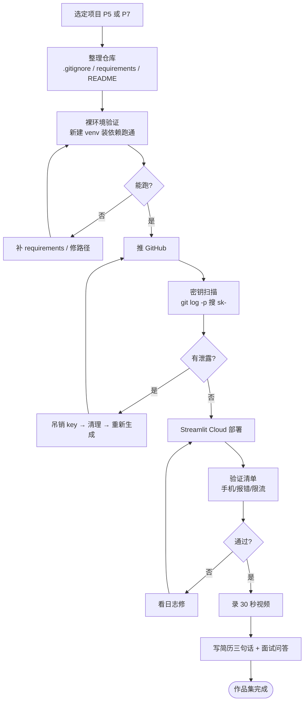

# P8 项目计划书 · 部署上线 + 作品集打包

> 难度：⭐⭐⭐⭐⭐ ｜ 周期：一个周末（约 4 小时）｜ 学习模块：M7
> **这是最后一个项目，也是前 7 个项目的"变现"环节。**
> **采用的资料**：见文末第 7 节

---

## 1. 项目要做什么

### 一句话

把你最好的那个项目（P5 或 P7）**部署成一个别人能点开的链接**，并打包成一套能投简历的作品集。

### 验收标准

- [ ] 有公网链接，手机能打开
- [ ] 换一台电脑，只按 README 的 3 条命令能跑起来
- [ ] 仓库里搜不到任何 `sk-` 开头的字符串
- [ ] 有 30 秒演示视频
- [ ] 有 README（含"我踩过的坑"）
- [ ] 有简历三句话
- [ ] 有 6 个面试问答的答案（写在纸上，能背）

### 明确不做

- ❌ 不做登录系统
- ❌ 不买域名（除非你已经买了）
- ❌ 不追求 UI 精美
- ❌ 不接支付

> **目标：让别人 30 秒内看懂你在做什么，并能亲手试。** 其他都是次要的。

---

## 2. 工具与开发环境

> 🛑 **本项目原则：不装新东西。**
> 需要的只有一个 GitHub 账号 + 一个部署平台账号（都免费）。

| 项 | 状态 | 说明 |
|---|---|---|
| GitHub 账号 | **需要**（免费） | 存代码、触发部署 |
| Streamlit Community Cloud | **需要**（免费，用 GitHub 登录） | 部署 |
| 你的项目（P5 或 P7） | 已有 | 待部署 |
| 一个新的虚拟环境 | 现场建 | 用于"裸环境验证" |
| 录屏工具 | 系统自带 | Win+G / 手机拍 |

### 关于"裸环境验证"

**这是本项目最重要的一步，也是最容易被跳过的一步。**

```bash
# 在一个全新目录，克隆你的仓库
git clone https://github.com/你的名字/你的项目.git
cd 你的项目

# 建全新环境
python -m venv .venv-test
.venv-test\Scripts\activate
pip install -r requirements.txt
streamlit run app.py
```

**为什么必须做**：你在自己的环境里"能跑"，是因为你半年里陆续装了几十个包。**别人拿到你的代码，只有 `requirements.txt`。**

> 90% 的"部署失败"在这一步就能提前发现。**在本地花 10 分钟，胜过在云端瞎猜 1 小时。**

---

## 3. 项目文件结构

一个"能交付"的仓库长这样：

```
my-rag-app/
├── .gitignore              ← 必须有，且必须含 .env
├── README.md               ← 必须有，且必须能照着跑
├── requirements.txt        ← 只列真正用到的包
├── .streamlit/
│   └── config.toml         ← 可选：主题、端口
├── app.py                  ← 入口
├── config.py
├── rag.py
├── store.py
├── data/
│   └── 售后政策.pdf
├── index/
│   ├── chunks.json         ← 提前建好，随仓库提交
│   └── vectors.npy
├── eval_set.json
└── docs/
    ├── demo.mp4            ← 演示视频（或放外链）
    └── screenshot.png
```

### 三个关键决策

| 决策 | 说明 |
|---|---|
| **索引文件要不要提交？** | **要**。它只有几百 KB，提交后云端不用重建，启动快 10 倍。**大文件（>50MB）才用外部存储** |
| **`data/` 里的 PDF 要不要提交？** | 要（如果是你自己的、不涉密的）。否则云端没法建库 |
| **`.env` 绝对不能提交** | 一条铁律，不再解释 |

### `requirements.txt` 怎么写才"干净"

```bash
# 不要用 pip freeze 直接导（会带上一堆无关的包）
# 手写，只写你 import 了的
```

```txt
openai>=1.0
python-dotenv
streamlit
numpy
pypdf
```

> `pip freeze` 会把 `pip`、`setuptools` 甚至你三个月前装的无关包全列进去，导致云端安装慢、还可能版本冲突。

---

## 4. 项目流程图（部署全流程）



### 为什么"密钥扫描"要放在推 GitHub 之后、部署之前

因为**推上去的那一刻就已经泄露了**。扫描是为了**立刻发现并止损**，不是为了"预防"。

真正的预防是在 `.gitignore` 里写 `.env`——但那只能防"以后"，防不了"你已经在本地 commit 过"。

---

## 5. 分步实现

### Step 1 · 整理仓库（40 分钟）

**① 写 `.gitignore`**

```gitignore
.env
.venv/
.venv-test/
__pycache__/
*.pyc
*.log
.streamlit/secrets.toml
.DS_Store
```

**② 写 `requirements.txt`**（手写，见上）

**③ 写 `README.md`**

````markdown
# 文档问答助手

上传一份 PDF，用大白话提问，答案带页码出处。

## 演示

[30 秒视频](docs/demo.mp4)

## 它解决什么问题
- 手册 50 页，找一个条款要翻半天
- 直接问 ChatGPT，它不知道你的文档，还爱编

## 技术方案
PDF 解析(pypdf) → 按页切分 → Embedding → 自建向量索引 → 检索 top-3 → 带引用生成

关键决策：
- 为什么不用 LangChain：只有一条链路，原生实现更可控
- 为什么按页切：保证引用能定位到页码

## 效果
20 题评测集：Recall@5 = 0.85，答对率 = 0.80，拒答正确率 = 1.00

## 怎么跑起来
```bash
pip install -r requirements.txt
# 在 .env 里配置 DEEPSEEK_API_KEY 和 EMBED_API_KEY
python build.py          # 建索引（已提交索引可跳过）
streamlit run app.py
```

## 我踩过的坑
1. ...
2. ...
````

**注意 README 的第一句**：不要写"这是一个基于 XXX 的系统"，要写**人话**——"上传一份 PDF，用大白话提问，答案带页码出处"。

> 招聘方只看 10 秒。**前两句决定他往不往下看。**

---

### Step 2 · 裸环境验证（30 分钟，**别跳**）

```bash
mkdir D:\test-clone
cd D:\test-clone
git clone <你的仓库地址>
cd <项目名>
python -m venv .venv-test
.venv-test\Scripts\activate
pip install -r requirements.txt
streamlit run app.py
```

**会遇到的问题和修法**：

| 报错 | 原因 | 修法 |
|---|---|---|
| `ModuleNotFoundError` | requirements 漏了 | 补上 |
| `FileNotFoundError: data/xxx.pdf` | 用了绝对路径 `D:\...` | 改成相对路径 `Path(__file__).parent / "data/..."` |
| `FileNotFoundError: index/...` | 索引没提交 | 提交索引，或加"首次运行自动建库" |
| `KeyError: 'DEEPSEEK_API_KEY'` | 没有 `.env` | README 里写清楚要配什么 |

**绝对路径是最高频的坑**。修法：

```python
from pathlib import Path
BASE = Path(__file__).parent
DATA = BASE / "data" / "售后政策.pdf"
```

> `Path(__file__).parent` 的意思是"以这个文件所在目录为基准"，**换到任何电脑都对**。

---

### Step 3 · 推 GitHub + 密钥扫描（20 分钟）

```bash
git init
git add .
git commit -m "init: 文档问答助手"
git remote add origin https://github.com/你的名字/my-rag-app.git
git push -u origin main
```

**立刻扫描**：

```bash
git log -p | findstr "sk-"        # Windows
git log -p | grep -E "sk-[a-zA-Z0-9]{20,}"   # Mac/Linux
```

**有输出 → 按这个顺序处理**：

1. **去平台吊销 key**（第一件事，别犹豫）
2. 生成新 key
3. 清理仓库（如果只提交了一次，可以 `git reset` 重来；多次的话用 `git filter-repo`）
4. 重新推

> 强调三遍也不为过：**先吊销，再清理。** 反过来做，key 已经被人拿去用了。

---

### Step 4 · 部署到 Streamlit Cloud（30 分钟）

1. 访问 https://share.streamlit.io ，用 GitHub 登录
2. New app → 选仓库 → 选分支 → 主文件填 `app.py`
3. **Advanced settings → Secrets**，填入：

```toml
DEEPSEEK_API_KEY = "sk-xxx"
EMBED_API_KEY = "xxx"
EMBED_BASE_URL = "https://..."
EMBED_MODEL = "embedding-3"
```

4. Deploy，等 2~5 分钟

**代码里这样读**（兼容本地和云端）：

```python
import os

def get_secret(name: str, default=None):
    try:
        import streamlit as st
        if name in st.secrets:
            return st.secrets[name]
    except Exception:
        pass
    return os.getenv(name, default)
```

> 这个函数让**同一份代码在本地和云端都能跑**。这是"可移植"的关键。

---

### Step 5 · 验证清单（20 分钟）

部署完**逐条**打勾：

| # | 检查 | 怎么查 |
|---|---|---|
| 1 | 链接能打开 | 无痕窗口打开（避免缓存骗你） |
| 2 | **手机能打开** | 用手机流量，不用 WiFi（模拟真实网络） |
| 3 | 首次加载多久 | 计个时。>30 秒要优化（多半是建索引） |
| 4 | 问一个正常问题 | 有答案、有引用 |
| 5 | 问一个库里没有的 | 正确拒答 |
| 6 | 把 Key 改错一次 | 显示人话错误，不是堆栈 |
| 7 | 输入超长文本 | 有长度限制提示 |
| 8 | 连续快速点 5 次 | 有防抖/限流，不报错 |

> 第 2 和第 3 条最容易被跳过，也最容易翻车。**手机端布局经常是坏的。**

---

### Step 6 · 加最基本的防护（30 分钟）

```python
import time

MAX_QUESTION_LEN = 500
MIN_INTERVAL = 1.5     # 秒

if "last_call" not in st.session_state:
    st.session_state.last_call = 0.0

q = st.chat_input("说点什么")

if q:
    if len(q) > MAX_QUESTION_LEN:
        st.warning(f"问题太长了，请精简到 {MAX_QUESTION_LEN} 字以内。")
        st.stop()

    now = time.time()
    if now - st.session_state.last_call < MIN_INTERVAL:
        st.warning("慢一点，我还在想上一个问题。")
        st.stop()
    st.session_state.last_call = now

    # ... 正常流程
```

**四行防护，挡住 90% 的"无意刷爆"。**

> 注意：这是**前端防抖**，不是真正的服务端限流。对个人作品集够用；真实产品要在服务端做。

---

### Step 7 · 录 30 秒视频（30 分钟）

**脚本（照着念/照着做）**：

| 秒 | 画面 | 说什么 |
|---|---|---|
| 0–5 | 打开链接 | "这是我的文档问答助手" |
| 5–12 | 输入"退款多久到账" | "它从我的 PDF 里找答案" |
| 12–18 | 展开引用 | "每个答案都有页码出处，能点开核对" |
| 18–25 | 问一个文档里没有的 | "不知道就说不知道，不瞎编" |
| 25–30 | 收起 | "完" |

**录制建议**：

- Win + G 录屏，或手机直接拍屏幕（**手机拍反而更真实**）
- **不要剪辑**，一口气录完，磕巴也没关系
- **不要配乐**，不要片头
- 视频放 `docs/demo.mp4`，或传到 B 站/YouTube 放链接

> 30 秒足够。**超过 1 分钟的视频，招聘方不会点开。**

---

### Step 8 · 简历三句话 + 面试问答（40 分钟）

**简历三句话（模板填空）**：

```
① 做了什么：独立实现【什么系统】，支持【3 个核心能力】。
② 怎么做的：采用【技术方案】，自建【N 题评测集】，通过【优化手段】提升【指标】。
③ 结果如何：【指标】从【X】提升至【Y】，已部署为【公开可访问的 Web 应用】。
```

**面试问答（写在纸上，能背）**：

| 问题 | 你要能答出（关键词） |
|---|---|
| 1. 你的 RAG 怎么评估的？ | 20 题评测集、四指标、gold chunk 人工标注、按题型分组分析 |
| 2. 为什么用混合检索？ | 向量擅长语义、BM25 擅长精确词；RRF 因为量纲不同不能直接加 |
| 3. 切分参数怎么定的？ | 试了 300/500/800，用评测集选；500 最好，300 会切断跨页答案 |
| 4. Agent 怎么防死循环？ | 步数上限、重复签名检测、错误转可读字符串回传 |
| 5. 密钥怎么管的？ | .env + .gitignore + 平台 secrets；泄露先吊销再清理 |
| 6. 用户量涨 100 倍怎么办？ | 缓存、限流、向量库换 Milvus、异步、成本监控、按题型路由到小模型 |

> **第 6 题没有标准答案，它考的是"你有没有想过"。** 能说出 3 条就已经很好。

---

### Step 9（可选）· FastAPI 版本

如果你想让"别的程序也能调"，加一个 `api.py`：

```python
from fastapi import FastAPI, HTTPException
from pydantic import BaseModel
from rag import answer
from store import load

app = FastAPI(title="RAG API")
chunks, matrix = load()


class AskRequest(BaseModel):
    question: str
    top_k: int = 3


@app.get("/health")
def health():
    return {"status": "ok", "chunks": len(chunks)}


@app.post("/ask")
def ask(req: AskRequest):
    if not req.question.strip():
        raise HTTPException(400, "问题不能为空")
    text, refs, best = answer(req.question, chunks, matrix, k=req.top_k)
    return {"answer": text, "sources": refs, "best_score": best}
```

```bash
uvicorn api:app --host 0.0.0.0 --port 8000
```

访问 `http://127.0.0.1:8000/docs` 就有可交互的接口文档。

> **这一步是可选的。** 加上它能让你在简历里多写一句"提供 RESTful API"，但会多花 1 小时。**先保证 Streamlit 版本活着。**

---

## 6. 项目进化方向

| 等级 | 加什么 | 价值 |
|---|---|---|
| Lv.1 | 加"示例问题"按钮 | 新人上手率提升巨大 |
| Lv.2 | 加"答案反馈"（👍/👎） | 收集真实评测数据 |
| Lv.3 | 加 FastAPI 版本 | 证明工程能力 |
| Lv.4 | 用 Docker 打包 | 部署到任何云 |
| Lv.5 | 加监控（Sentry / 自建日志看板） | 生产意识 |
| Lv.6 | 换成真前端（Next.js） | 产品化 |

### 关于 Docker（要不要学）

**建议：M7 之后，花 2 小时学最小 Docker。**

```dockerfile
FROM python:3.11-slim
WORKDIR /app
COPY requirements.txt .
RUN pip install -r requirements.txt
COPY . .
CMD ["streamlit", "run", "app.py", "--server.port=8501", "--server.address=0.0.0.0"]
```

**为什么值**：一句 `docker build` + `docker run` 能跑在**任何**装了 Docker 的机器上。这是"部署能力"的通用语言。

> 🛑 **装 Docker Desktop 之前先问我**（它比较大，且 Windows 需要 WSL2）。

---

## 7. 本项目采用的资料

| 步骤 | 参考 | 出处 |
|---|---|---|
| Step 1 README 结构 | llm-universe 第 6 章（项目展示） | https://datawhalechina.github.io/llm-universe/ |
| Step 2 裸环境验证 | 仓库06 环境排错篇 | https://github.com/Hoper-J/AI-Guide-and-Demos-zh_CN |
| Step 4 部署 | Streamlit 官方文档 · Deploy your app | https://docs.streamlit.io/deploy |
| Step 4 secrets | Streamlit · Secrets management | https://docs.streamlit.io/deploy/streamlit-community-cloud/deploy-your-app/secrets-management |
| Step 9 接口 | FastAPI 中文文档 · 第一步 | https://fastapi.tiangolo.com/zh/tutorial/first-steps/ |
| Step 9 数据校验 | FastAPI · 请求体与 Pydantic | https://fastapi.tiangolo.com/zh/tutorial/body/ |

---

## 交付清单（逐条打勾，全部完成才算结课）

- [ ] GitHub 仓库公开可访问
- [ ] 仓库里搜不到 `sk-`（`git log -p` 验证过）
- [ ] 裸环境（新建 venv）按 README 能跑通
- [ ] 有公网链接，手机能打开
- [ ] 5 类输入都测试过（正常/超长/空/无关/连续点）
- [ ] 有 30 秒视频
- [ ] README 含"我踩过的坑"≥2 条
- [ ] 简历三句话写好
- [ ] 6 个面试问答能背
- [ ] 进度看板最后一个勾打上

---

## 结课之后

你已经走完了 16 周。回头看，你手里有：

| 项目 | 证明的能力 |
|---|---|
| P5 文档问答 | 会搭 RAG |
| P6 带评测的 RAG | 会**衡量**和**优化** |
| P7 多功能 Agent | 会做**决策型**应用 |
| P8 部署上线 | 能**交付** |

**这四件事加起来，就是"AI 应用工程师"的完整画像。**

### 接下来三个方向（选一个深挖）

| 方向 | 学什么 | 能做什么岗位 |
|---|---|---|
| **RAG 深水区** | 多模态检索、GraphRAG、检索评估体系 | RAG 工程师 |
| **Agent 深水区** | 多 Agent 协作、规划、记忆系统 | Agent 工程师 |
| **工程化** | Docker、K8s、可观测性、成本优化 | AI 平台/后端 |

> **别三个都学。** 选一个，再做 2 个真实项目。**深度 > 广度**，在这个阶段尤其如此。

### 最后一句

> 你现在的水平，大概超过了 80% "在学 AI" 的人。
> 不是因为你聪明，是因为**你把东西做出来了，还量了数字**。
> 大多数人停在"看完了教程"。
